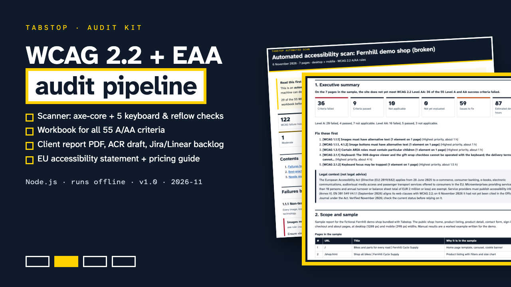

# Tabstop

**Tabstop: WCAG 2.2 + European Accessibility Act Audit Kit**

One ZIP: a Node.js WCAG 2.2 scanner (axe-core + Playwright), a 55-criterion manual test workbook, a report, ACR and Jira/Linear backlog generator, EU accessibility statement templates, a demo site, a 16-page START-HERE PDF and a 16-page pricing guide.

**Price:** $59 · **Category:** Software · **Edition:** 2026-11

### [Get it on Gumroad →](https://kitwright.gumroad.com/l/tabstop-audit-kit?utm_source=github&utm_medium=readme&utm_campaign=accessibility-audit-kit)

---

For freelance developers, agencies and in-house teams who have to audit websites against WCAG 2.2 AA now that the European Accessibility Act applies (since 28 June 2025). Checklists are free; a repeatable pipeline from scan to client report is not, and that is what this kit is.

### What you get

- **Automated scanner** (Node.js, runs on your machine): reads a sitemap, a URL list or crawls a site; runs axe-core 4.14.0 through Playwright 1.64.1 at desktop (1280 px) and mobile (390 px) widths; takes screenshots of failing elements; writes JSON and an HTML report grouped by WCAG criterion with severity and written fix guidance for all 100 current axe rules.
- **5 extra checks axe does not do**: focus not visible (2.4.7), focus hidden behind sticky or fixed content (2.4.11, new in WCAG 2.2), keyboard traps (2.1.2), horizontal scrolling at 320 px / 400% zoom (1.4.10), paste blocked in password fields (3.3.8, new in 2.2). Each one is labelled "confirm by hand".
- **Manual test workbook** for all 55 WCAG 2.2 Level A and AA criteria (each exactly once, checked against the W3C list): what automation cannot catch, step-by-step procedures for keyboard, VoiceOver, NVDA, zoom and reflow, contrast, motion, forms, target size, dragging, consistent help, redundant entry and accessible authentication. Excel (.xlsx with dropdowns and live summary), CSV and an offline HTML version.
- **Report generator** that merges scan and workbook into: a client-ready audit report (HTML and PDF), an Accessibility Conformance Report draft with the VPAT 2.5Rev WCAG structure, a remediation backlog with effort estimates for Jira and Linear (CSV), and a pre-filled accessibility statement.
- **EU accessibility statement templates**: EAA service information (Annex V) and the EU public-sector model statement.
- **Scoping and Pricing Guide** (16 pages) with a scoping calculator (.xlsx), three worked quotes, an 18-question client intake questionnaire and 13 statement-of-work clauses.
- **Demo shop** with 55 planted barriers and a fixed version: the scanner finds the 43 that tools can find; the other 12 show why manual testing matters.
- **7 console snippets and bookmarklets** for manual tests (text spacing, focus order, headings, landmarks, image alternatives, target size, motion).
- **16-page START-HERE PDF** and a sample output folder with a real 51-page audit report PDF.

### How it works

1. Install Node.js 20+, unzip, run **npm run setup** once (installs the pinned packages from the lockfile and a headless browser).
2. Run **npm run demo**: about 10 minutes from download to a full sample audit.
3. Scan your site: **npm run scan -- --sitemap https://your-site/sitemap.xml** (logged-in pages and basic-auth staging supported).
4. Test the criteria a machine cannot judge with the workbook, then **npm run report**.

### Honest about automation

29 of the 55 WCAG 2.2 A/AA criteria have no automated test in any tool, including this one. The kit never marks a criterion as passed from a scan: a Pass only comes from your manual result, conflicts between manual and automated results are flagged, and the ACR draft warns about untested rows. Screen-reader behaviour must be checked by a person with real assistive technology.

### Who this is not for

- Anyone looking for a one-click "compliance" badge or overlay. This is a professional audit workflow and needs a person to do the manual testing.
- Native mobile apps, PDFs and documents: the tools and procedures cover web content (WCAG / EN 301 549 clause 9).
- People who cannot run a command in a terminal (the workbook, templates and guides still work without it).

### Format and requirements

- One ZIP, about 4.0 MB, 305 files: Node.js code you can use on unlimited client projects (see LICENSE.txt), .xlsx, .csv, .html, .md and .pdf files.
- Requires Node.js 20 or newer on macOS, Windows or Linux, and about 600 MB of disk for packages and the headless browser. Internet is needed once for setup; then everything runs offline and nothing is sent anywhere.
- Optional: Excel, LibreOffice, Numbers or Google Sheets for the .xlsx files; NVDA and VoiceOver are free.
- This is a digital download, not a printed book.

### Updates

Free updates for this edition (v1.x, edition 2026-11), for example when EN 301 549 V4.1.1 is cited in the Official Journal or axe-core releases new rules. Standards facts were verified on 6 November 2026 with sources listed in the kit.

### Disclaimer

Not legal advice and not a certification. The kit helps you evaluate a sample of pages; it cannot guarantee that a website conforms to WCAG or complies with any law. Not affiliated with W3C, ITI, ETSI, the European Commission, Deque, Microsoft, Atlassian or Linear. VPAT is a registered service mark of the Information Technology Industry Council.

---

**Keywords:** accessibility, wcag 2.2, accessibility audit, eaa, vpat, a11y, web accessibility, axe-core

[← All Kitwright kits](../../README.md) · [Buy on Gumroad](https://kitwright.gumroad.com/l/tabstop-audit-kit?utm_source=github&utm_medium=readme_footer&utm_campaign=accessibility-audit-kit)
