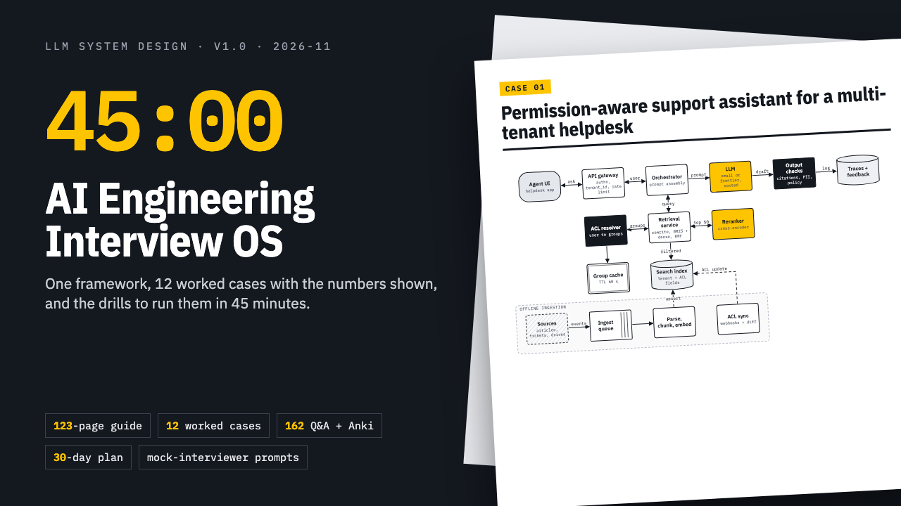

# AI Engineering Interview OS

**AI Engineering Interview OS: LLM System Design for Senior & Staff Engineers**

ZIP download: 123-page LLM system design guide with 12 worked cases, 162 Q&A (PDF + Anki), 30-day plan, scoring rubric and mock-interviewer prompts.

**Price:** $59 · **Category:** Education · **Edition:** 2026-11

### [Get it on Gumroad →](https://kitwright.gumroad.com/l/ai-interview-os?utm_source=github&utm_medium=readme&utm_campaign=ai-engineering-interview-os)

---

**For software engineers, mid-level to staff, interviewing for AI and LLM engineering roles.** The LLM system design round now decides these offers, and it tests what classic system design prep never covered: retrieval quality, evaluation, prompt injection, token economics and agent safety.

This is a complete offline preparation system: one repeatable answer framework, 12 fully worked cases with every number shown, and the drills that make it automatic in two to four weeks.

### What you get

- **Main guide (123-page PDF).** An eleven-step answer framework (clarify, requirements and SLOs, data, model strategy, retrieval, orchestration and tools, evaluation, safety and security, latency and cost, operations, iteration), a minute-by-minute plan for a 45-minute interview, a back-of-envelope toolkit with explicit arithmetic, four reference architectures, decision tables and a failure-mode catalog.
- **12 fully worked case studies:** permission-aware support assistant for a multi-tenant helpdesk; AI coding assistant for a 3,000-engineer monorepo; structured extraction from two million documents a month; account-action agent with tool calling and human approval; semantic search over a billion listings; an LLM evaluation platform for forty product teams; LLM-assisted content moderation at 50 million posts a day; real-time phone voice agent for clinic appointments; fine-tune, RAG or prompt? Contract drafting for a legal-tech company; guardrails for a customer-facing banking assistant; cutting the cost of a live LLM feature by 60% in one quarter; multi-agent deep-research system with verifiable citations. Each has the prompt as an interviewer says it, clarifying questions, an architecture diagram, a design walkthrough, a trade-off table, the numbers, failure modes, five follow-up questions with strong answers, and what weak, strong and staff-level answers sound like.
- **Question bank: 162 questions with concise answers** across 18 topics (embeddings, chunking, hybrid search and reranking, vector indexes, context management, caching, quantization and serving, batching, fine-tuning, evals, hallucination, prompt injection, agents, structured outputs, MCP, observability, cost control, privacy). Included as a 38-page PDF, an Anki deck and a CSV file.
- **30-day study plan** with daily tasks and checkboxes, plus a 14-day compressed plan.
- **Self-scoring rubric:** eight dimensions with behavioral anchors and level bars for mid-level, senior and staff, printable scorecards and a progress tracker.
- **Mock-interviewer kit:** copy-paste prompts that turn Claude, ChatGPT or a similar assistant into an interviewer who withholds facts, keeps time and pushes back, plus a grader prompt that scores your transcript against the rubric. 18 case cards: 12 matching the guide and 6 unseen cases with no published solution.
- **START-HERE guide** that gets you to a first practice result in ten minutes.

### How it works

1. Unzip and open START-HERE.pdf. Do the ten-minute first exercise.
2. Pick the 4-week plan (60 to 90 minutes a day) or the 2-week plan (about 2 hours a day).
3. For each case: attempt it cold for 45 minutes, alone or with the AI interviewer; score it with the rubric; read the worked solution; redo the follow-up questions two days later.

Setup takes about five minutes. Importing the Anki deck is optional.

### Who it is not for

- Beginners to software engineering. It assumes you know what an API, a database, a cache and an embedding are.
- Anyone looking for leaked or "real" company interview questions. There are none here, by design.
- Research-scientist interviews focused on new model architectures or ML theory.

### Format and requirements

- One ZIP file (about 4 MB) containing 6 PDFs (US Letter, print-friendly), an Anki .apkg deck, a CSV file and plain-text prompt files.
- Needs any PDF reader. Optional: Anki (free on desktop and Android) for the flashcards, and an AI chat assistant such as Claude or ChatGPT for the mock interviews.
- Works offline, except the optional AI mocks. No account, no login, no community to join.
- This is a digital download, not a printed book.

### Updates

Version 1.0, edition 2026-11. Free updates for this edition. Prices, latencies and context sizes are illustrative figures dated November 2026, with the arithmetic shown, so the method stays valid as prices change. Fast-moving facts (protocol versions, security lists, regulatory guidance) carry a dated note and a source.

### Disclaimer

Independent product. Not affiliated with, endorsed by or based on internal materials of any company, model vendor, product or interview platform named, including Anthropic, OpenAI and Google. All trademarks belong to their owners. Educational material only; it is not legal or compliance advice and does not guarantee interviews or offers.

---

**Keywords:** system design, ai engineer, llm, interview prep, rag, ai agents, staff engineer, ml interview

[← All Kitwright kits](../../README.md) · [Buy on Gumroad](https://kitwright.gumroad.com/l/ai-interview-os?utm_source=github&utm_medium=readme_footer&utm_campaign=ai-engineering-interview-os)
