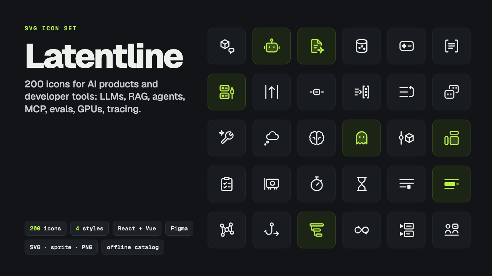

# Latentline

**Latentline: 200 SVG Icons for AI Products & Dev Tools (React, Vue, Figma)**

One ZIP: 200 SVG icons for AI and developer tools in 4 styles, 4 sprites, 4,000 PNGs, React and Vue packages, Figma files, an offline catalog and 2 PDF guides.

**Price:** $39 · **Category:** Design · **Edition:** 2026-11

### [Get it on Gumroad →](https://kitwright.gumroad.com/l/latentline?utm_source=github&utm_medium=readme&utm_campaign=ai-icon-set)

---

For product designers and front-end developers building AI products and developer tools. General-purpose icon sets stop at "settings" and "search"; when your UI needs a context window, a reranker, an MCP server, a guardrail or a LoRA adapter, you end up drawing it yourself or using a robot emoji.

**Latentline is 200 icons for exactly those concepts**, drawn on one 24 px grid with one stroke logic, in four styles, with ready-made React and Vue components.

### What you get

- **200 icons in 11 categories**: Models & Architecture (14), Prompts & Context (20), AI Capabilities (19), Retrieval & Knowledge (18), Agents & Tools (22), Training & Data (19), Evaluation & Safety (19), Inference & Compute (19), APIs & Infrastructure (17), DevOps & Observability (16), Code & Collaboration (17).
- **Examples**: llm, system-prompt, context-window, token, temperature, embedding, vector-database, rag, reranker, agent, multi-agent, tool-call, function-calling, mcp-server, guardrail, hallucination, eval, llm-judge, pii-redaction, fine-tune, lora, quantization, gpu, latency, rate-limit, streaming, webhook, feature-flag, trace, ci-cd, notebook, pair-programming.
- **4 styles, 800 optimised SVGs**: outline 1.5 px (default), outline 1 px, outline 2 px and duotone. Only currentColor, so icons follow your text colour.
- **4 SVG sprites**, one per style.
- **4,000 PNGs**: outline and duotone, black and white, at 16, 24, 32, 48 and 64 px.
- **React and Vue 3 packages**: typed (TypeScript), tree-shakable (one module per icon), with size, strokeWidth, variant, color and title props. Installable from the included .tgz files; source included.
- **Offline HTML catalog**: search by name and tag, filter by category, preview every style and size, copy SVG, React, Vue or sprite code with one click.
- **Figma-ready files**: per-category folders and two grouped sheets with every icon named category/icon-name.
- **START-HERE.pdf** (14 pages: setup for HTML, React, Vue and Figma, a variant decision table, troubleshooting, full icon index) and **Design-Spec.pdf** (9 pages: grid, keylines, stroke and gap rules, naming, how to draw a matching icon).
- icons.json with every name, category, tags and component name, plus LICENSE.txt and CHANGELOG.md.

### How it works

1. Unzip and double-click catalog/index.html. It runs offline in any modern browser.
2. Search, pick a style, click an icon, copy the SVG and paste it into your page. That takes about two minutes.
3. For React or Vue, run one npm install pointing at the included .tgz, then import icons by name (for example IconVectorDatabase).
4. For Figma, drag a category folder onto the canvas and create components.

Every icon passes automated checks: valid SVG, 24 x 24 viewBox, geometry inside a 2 px margin, consistent stroke width per style, no hidden elements, and at least 1 px of clear space between separate strokes at the default 1.5 px weight (0.85 px in the two globe icons, web-search and web-crawler, where the meridian meets the outline).

### Who it is not for

- If you need thousands of general icons (arrows, files, weather), use a free general-purpose set; Latentline is designed to sit next to one, on the same 24 px grid.
- It is not a logo pack. It contains no brand marks of AI companies, cloud providers or tools.
- There is no icon font, and no Svelte or Angular package. Those frameworks can use the SVG files and the sprite directly.

### Format and requirements

- One ZIP download (about 6 MB) with SVG, PNG, HTML, PDF, JSON, TypeScript/JavaScript and .tgz files.
- SVG and PNG files work in any browser, design tool or slide app. The catalog needs only a web browser.
- The React package needs React 18 or 19, and the Vue package needs Vue 3.3 or later, plus Node.js and npm to install. They were tested with React 19.3, Vue 3.5 and TypeScript 5.9 and 7.0.
- The Figma files import by drag and drop. The import itself was not tested inside Figma by the author; the steps follow Figma's documentation.
- This is a digital download, not a physical product.

### Licence

Use the icons in unlimited personal and commercial projects, including client work, apps, SaaS products and open-source projects, and modify them freely. You may not resell or redistribute the icons themselves, for example as an icon set, UI kit, template or public npm package.

### Updates

Free updates for this edition (2026-11): new icons and fixes are added to the same download in your Gumroad library. Icon names stay stable within a version, so updates do not break your imports.

---

*Latentline depicts general concepts. It is not affiliated with or endorsed by any AI lab, cloud provider, framework or design-tool vendor mentioned in tags or documentation.*

---

**Keywords:** icon set, svg icons, ai icons, react icons, figma icons, developer tools, line icons, ui design

[← All Kitwright kits](../../README.md) · [Buy on Gumroad](https://kitwright.gumroad.com/l/latentline?utm_source=github&utm_medium=readme_footer&utm_campaign=ai-icon-set)
