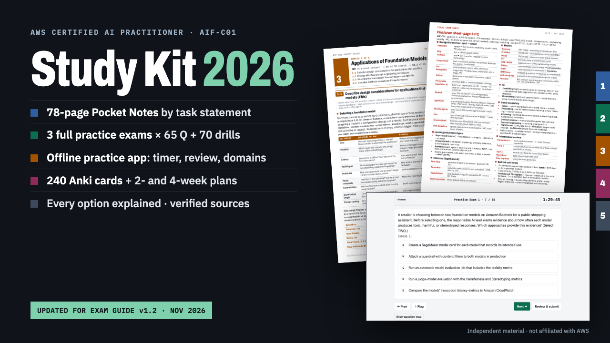

# AWS AI Practitioner (AIF-C01) Study Kit

**AWS AI Practitioner (AIF-C01) Study Kit: Notes, 3 Practice Exams, Anki**

78-page pocket notes PDF + offline practice app (3 full 65-question exams + 70 drills) + 240 Anki cards + 2/4-week plan. Exam guide v1.2, Nov 2026.

**Price:** $39 · **Category:** Software · **Edition:** 2026-11

### [Get it on Gumroad →](https://kitwright.gumroad.com/l/aif-c01-study-kit?utm_source=github&utm_medium=readme&utm_campaign=aws-ai-practitioner-kit)

---

**For anyone preparing for the AWS Certified AI Practitioner (AIF-C01) exam who wants one accurate, current kit instead of a pile of outdated courses.** AWS rewrote the exam guide in 2026, adding agentic AI, MCP, Amazon Bedrock AgentCore, Strands Agents, Kiro and Amazon Quick. It has also closed Amazon Kendra, Amazon Q Business, Bedrock Agents (now "Agents Classic"), SageMaker Clarify and several other services to new customers. Most study material written before then still teaches those as the right answers. This kit was built and fact-checked against the current guide (v1.2, published October 29, 2026) and AWS documentation as of November 5, 2026.

### What you get

- **Pocket Notes PDF (78 pages, 6×9 in).** Organized by the 14 task statements of the exam guide, with a table of contents, page numbers and colored domain tabs. Inside: "which service when" decision tables, about 25 side-by-side comparisons of commonly confused services and concepts, traps and keyword signals for every task, key numbers, responsible AI, and security and governance chapters. It ends with a 2-page final cram sheet.
- **A "verified" box on every stale-prone fact**, with the AWS source, plus a one-page table of retired and maintenance-mode services: what each did, its status date, and what to use instead.
- **Offline practice-test app (one HTML file).** 265 original questions: 3 full practice exams of 65 questions each, matching the official domain weights, plus 70 domain-drill questions. Every question has an explanation for each option (why it is right or wrong) and a domain/task tag.
- All four current question types: multiple choice, multiple response ("Select TWO"), ordering and matching.
- **Exam mode:** 90-minute timer, flagging, review screen, a domain breakdown, and a scaled-score estimate that is clearly labeled as an estimate. **Practice mode:** instant feedback, a domain filter, and re-drilling the questions you missed. Results by domain are saved on your own device.
- **Anki deck:** 240 flashcards taken from the notes, in subdecks per domain.
- **START-HERE PDF:** your first 10 minutes step by step, a 2-week plan and a 4-week plan, how to use the app, and how to book the exam (through the official AWS page).
- The question bank as raw JSON, CHANGELOG and LICENSE.

### How it works

1. Unzip the download and open START-HERE.pdf.
2. Double-click the practice app and run a 10-question set. You'll see an explanation for every option within about 10 minutes of downloading.
3. Follow the 2-week (about 1.5–2 h/day) or 4-week (about 45–60 min/day) plan: read a task statement, drill it, review the flashcards, then sit the three timed exams.

Setup time: none. No account, no login, no internet connection, nothing to install except Anki if you want the flashcards.

### Who this is NOT for

- Anyone looking for real exam questions or "dumps". These questions are original, and the kit does not contain or claim to contain actual exam content.
- Associate- or professional-level candidates (for example ML Engineer Associate or Generative AI Developer Professional). This covers the foundational AIF-C01 scope only.
- Anyone who wants video lessons or hands-on labs. This is a reading, practice and recall kit.

### Format and requirements

- One ZIP file containing PDFs, an HTML file (the app), an .apkg file (the Anki deck), a JSON file and two text files.
- The PDFs open in any PDF reader. The app runs offline in a current Chrome, Edge, Firefox or Safari on Windows, macOS or Linux, and also opens on tablets. The flashcards need Anki (free on desktop and Android; AnkiMobile on iOS is a paid app from its developer).
- This is a digital download, not a printed book.

### Updates

Free updates for this edition. AWS revises the exam guide and retires services with little notice. When that affects the kit, an updated version is posted here and you can download it again from your Gumroad library.

### Disclaimer

Independent study material. Not affiliated with, endorsed by, or sponsored by Amazon Web Services. AWS and the AWS service names are trademarks of Amazon.com, Inc. or its affiliates. The practice questions are original and written for this kit; they are not exam questions. No pass guarantee. Exam details can change, so confirm them on the official AWS certification page before booking.

---

**Keywords:** aws, aws certification, aif-c01, ai practitioner, practice exam, amazon bedrock, anki, study guide

[← All Kitwright kits](../../README.md) · [Buy on Gumroad](https://kitwright.gumroad.com/l/aif-c01-study-kit?utm_source=github&utm_medium=readme_footer&utm_campaign=aws-ai-practitioner-kit)
