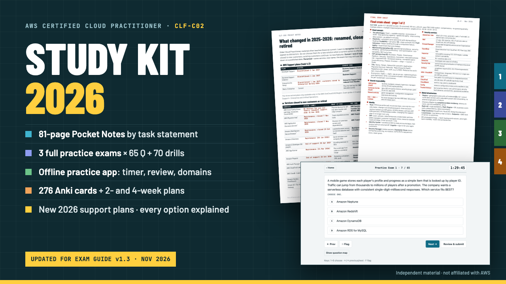

# AWS Cloud Practitioner (CLF-C02) Study Kit

**AWS Cloud Practitioner (CLF-C02) Study Kit: Notes, 3 Practice Exams, Anki**

81-page pocket notes PDF + offline practice app (3 full 65-question exams + 70 drills) + 276 Anki cards + 2/4-week plan. Exam guide v1.3, Nov 2026.

**Price:** $39 · **Category:** Software · **Edition:** 2026-11

### [Get it on Gumroad →](https://kitwright.gumroad.com/l/clf-c02-study-kit?utm_source=github&utm_medium=readme&utm_campaign=aws-cloud-practitioner-kit)

---

**For anyone preparing for the AWS Certified Cloud Practitioner (CLF-C02) exam who wants one accurate, current kit instead of courses that still teach 2023 facts.** The exam code has not changed, but AWS has: the exam guide now names the new AWS Support plans (Business Support+ and Unified Operations replace Developer, Business and Enterprise On-Ramp, which end on January 1, 2027), QuickSight is now Amazon Quick, the Snow Family is closed to new customers, and Migration Hub, Application Discovery Service and WorkSpaces Secure Browser no longer take new customers. This kit was built and fact-checked against exam guide v1.3 (published October 29, 2026) and AWS documentation as of November 6, 2026.

### What you get

- **Pocket Notes PDF (81 pages, 6×9 in).** Organized by the 19 task statements of the exam guide, with a table of contents, page numbers and colored domain tabs. Inside: "which service when" decision tables, side-by-side comparisons of commonly confused services (CloudTrail vs CloudWatch vs Config, security groups vs network ACLs, Savings Plans vs Reserved Instances and more), traps and keyword signals for every task, worked cost examples, the shared responsibility model by service, and the 2026 AWS Support plans with prices and response times. It ends with a 2-page final cram sheet.
- **A "Verified Nov 2026" box on every stale-prone fact**, with the AWS source, plus a "What changed in 2025–2026" table of renamed, closed and retired services: the status date and what to choose instead.
- **Offline practice-test app (one HTML file).** 265 original questions: 3 full practice exams of 65 questions each in the official domain mix (16 / 19 / 22 / 8), plus 70 domain-drill questions. Every option has its own explanation (why it is right or wrong), and every question has a domain and task tag and a link to the AWS documentation.
- Both official question types: multiple choice and multiple response ("Select TWO").
- **Exam mode:** 90-minute timer, flagging, review screen, a domain breakdown, and a scaled-score estimate that is clearly labeled as an estimate. **Practice mode:** instant feedback, a domain filter, and re-drilling the questions you missed. Results by domain are saved on your own device.
- **Anki deck:** 276 flashcards taken from the notes, in subdecks per domain plus a "commonly confused" deck.
- **START-HERE PDF:** your first 10 minutes step by step, a 2-week plan and a 4-week plan, how to use the app, and how to book the exam (through the official AWS page).
- The question bank as raw JSON, CHANGELOG and LICENSE.

### How it works

1. Unzip the download and open START-HERE.pdf.
2. Double-click the practice app and run a 10-question set. You'll see an explanation for every option within about 10 minutes of downloading.
3. Follow the 2-week (about 1.5–2 h/day) or 4-week (about 45–60 min/day) plan: read a task statement, drill it, review the flashcards, then sit the three timed exams.

Setup time: none. No account, no login, no internet connection, nothing to install except Anki if you want the flashcards.

### Who this is NOT for

- Anyone looking for real exam questions or "dumps". These questions are original, and the kit does not contain or claim to contain actual exam content.
- Associate-level candidates (for example Solutions Architect or Developer). This covers the foundational CLF-C02 scope only.
- Anyone who wants video lessons or hands-on labs. This is a reading, practice and recall kit.

### Format and requirements

- One ZIP file containing PDFs, an HTML file (the app), an .apkg file (the Anki deck), a JSON file and two text files.
- The PDFs open in any PDF reader. The app runs offline in a current Chrome, Edge, Firefox or Safari on Windows, macOS or Linux. The flashcards need Anki (free on desktop and Android; AnkiMobile on iOS is a paid app from its developer).
- This is a digital download, not a printed book.

### Updates

Free updates for this edition. AWS revises the exam guide and retires services with little notice. When that affects the kit, an updated version is posted here and you can download it again from your Gumroad library.

### Disclaimer

Independent study material. Not affiliated with, endorsed by, or sponsored by Amazon Web Services. AWS and the AWS service names are trademarks of Amazon.com, Inc. or its affiliates. The practice questions are original and written for this kit; they are not exam questions. No pass guarantee. Exam details can change, so confirm them on the official AWS certification page before booking.

---

**Keywords:** aws, aws certification, clf-c02, cloud practitioner, practice exam, aws cloud, anki, study guide

[← All Kitwright kits](../../README.md) · [Buy on Gumroad](https://kitwright.gumroad.com/l/clf-c02-study-kit?utm_source=github&utm_medium=readme_footer&utm_campaign=aws-cloud-practitioner-kit)
