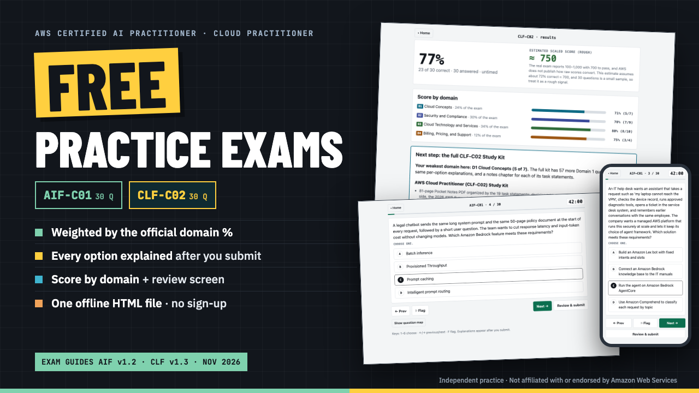

# Free AWS Practice Exams

**Free AWS Practice Exams: AIF-C01 and CLF-C02, 30 Questions Each**

Free offline app: two 30-question practice exams (AIF-C01 and CLF-C02) weighted by the official domain %, every option explained, domain scores and a review screen.

**Price:** Free ($0+) · **Category:** Software · **Edition:** 2026-11

### [Get it on Gumroad →](https://kitwright.gumroad.com/l/aws-free-practice-exams?utm_source=github&utm_medium=readme&utm_campaign=aws-free-practice-exams)

---

**Two free practice exams for AWS Certified AI Practitioner (AIF-C01) and AWS Certified Cloud Practitioner (CLF-C02), 30 questions each, in one app that runs offline in your browser.** Find out where you stand before you spend money on a course: each exam is weighted by the official domain percentages, every answer option is explained after you submit, and you get a score for each domain. The questions follow the current exam guides (AIF-C01 v1.2 and CLF-C02 v1.3, both published October 29, 2026), including AWS's 2026 service changes.

### What you get

- **AIF-C01 free exam: 30 questions** across the five domains (6 / 7 / 9 / 4 / 4), in all four question types: multiple choice, multiple response ("Select TWO"), ordering and matching.
- **CLF-C02 free exam: 30 questions** across the four domains (7 / 9 / 10 / 4), in both official question types: multiple choice and multiple response.
- **Weighted like the real exam.** Each domain gets 30 × its official weight, rounded so the total is exactly 30 (the method and the numbers are shown in the app). Every task statement in each guide is covered at least once.
- **Timed or untimed.** Timed mode runs at the real exam's pace (42 minutes for 30 questions, the same as 90 minutes for 65). Flag questions, jump with the question map, and check answered, unanswered and flagged questions on the review screen before you submit.
- **Results you can act on:** overall score, a score for each domain, a rough scaled-score estimate (clearly labeled as an estimate), and an answer review that explains why every option is right or wrong, with a one-line rule to remember and links to the AWS documentation.
- **START-HERE PDF:** how to use the app, how the questions were chosen, how to read your score, and what the full study kits add.

### How it works

1. Download and unzip the file.
2. Double-click Free-AWS-Practice-Exams.html. It opens in your browser.
3. Pick AIF-C01 or CLF-C02, timed or untimed, and start. A timed exam takes up to 42 minutes.

Setup time: none. No account, no sign-up, no internet connection, nothing to install. Your progress and last scores stay in your own browser.

### Where the questions come from

The 60 questions are a sample from the question banks of our two paid study kits, taken from their domain-drill sets. They are original questions written from the public exam guides and AWS documentation, each with an explanation for every option, and they passed the kits' automated checks and a second review for this edition. If you want more after the free exams, the full kits add:

- **AWS AI Practitioner (AIF-C01) Study Kit:** 265 questions (3 full timed 65-question exams plus 70 drills), a practice mode with instant feedback, a 78-page notes PDF by the 14 task statements, 240 Anki flashcards, and 2- and 4-week study plans. [kitwright.gumroad.com/l/aif-c01-study-kit](https://kitwright.gumroad.com/l/aif-c01-study-kit)
- **AWS Cloud Practitioner (CLF-C02) Study Kit:** 265 questions (3 full timed 65-question exams plus 70 drills), a practice mode with instant feedback, an 81-page notes PDF by the 19 task statements including the 2026 AWS Support plans, 276 Anki flashcards, and 2- and 4-week study plans. [kitwright.gumroad.com/l/clf-c02-study-kit](https://kitwright.gumroad.com/l/clf-c02-study-kit)

None of the 30 free questions for an exam appears in that kit's three full practice exams, so those stay a fresh test.

### Who this is NOT for

- Anyone looking for real exam questions or "dumps". These questions are original and do not contain or claim to contain actual exam content.
- Associate- or professional-level candidates. These exams cover the foundational AIF-C01 and CLF-C02 scope only.
- Anyone who wants a full course. This is a 30-question check per exam, not a study program.

### Format and requirements

- One ZIP file containing one HTML file (the app), START-HERE.pdf, and two text files (CHANGELOG and LICENSE).
- The app runs offline in a current Chrome, Edge, Firefox or Safari on Windows, macOS or Linux, and its layout works on phone-sized screens. The PDF opens in any PDF reader.
- This is a digital download, not a printed book.
- Free. You can pay what you want if you find it useful, but $0 is fine.

### Updates

Free updates for this edition. AWS revises exam guides and retires services with little notice; when that affects a question, an updated version is posted here and you can download it again.

### Disclaimer

Independent practice material. Not affiliated with or endorsed by Amazon Web Services. AWS and the certification names are trademarks of Amazon.com, Inc. or its affiliates and are used only to say which exams this practice is for. The practice questions are original; they are not exam questions. No pass guarantee. Exam details can change, so confirm them on the official AWS certification pages before booking.

---

**Keywords:** aws, aws certification, aif-c01, clf-c02, practice exam, free practice test, cloud practitioner, ai practitioner

[← All Kitwright kits](../../README.md) · [Buy on Gumroad](https://kitwright.gumroad.com/l/aws-free-practice-exams?utm_source=github&utm_medium=readme_footer&utm_campaign=aws-free-practice-exams)
