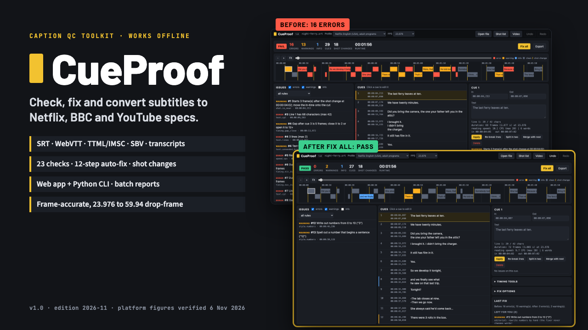

# CueProof

**CueProof: Subtitle & Caption QC Toolkit (SRT, WebVTT, TTML), Works Offline**

Offline web app + Python CLI: 23 QC checks, 12-step auto-fix, SRT/WebVTT/TTML/SBV/TXT, Netflix/BBC/YouTube profiles, START-HERE and Guide PDFs.

**Price:** $29 · **Category:** Video · **Edition:** 2026-11

### [Get it on Gumroad →](https://kitwright.gumroad.com/l/cueproof?utm_source=github&utm_medium=readme&utm_campaign=caption-qc-toolkit)

---

For video editors, YouTubers and subtitle freelancers who deliver caption files and keep getting them bounced for 43-character lines, 2-frame gaps, cues that start just after a cut or read too fast. CueProof checks SRT, WebVTT and TTML files against Netflix, BBC and YouTube-ready profiles, fixes what can be fixed safely, and tells you exactly what is left and why, all on your own computer with no subscription.

### What you get

- **CueProof web app (one HTML file):** drag a caption file in and see every issue on a timeline next to your shot changes, fix all or cue by cue, re-time, preview against your video, and export SRT, WebVTT, TTML/IMSC 1.1, YouTube SBV or a transcript, plus an HTML QC report or CSV.
- **Command-line tool (Python 3.9+, nothing to install):** check, fix, reflow, convert, shift, frame-rate conversion, two-point sync, shot detection with ffmpeg, and batch mode that writes a report for every file in a folder.
- **23 checks:** characters per line, line count, characters per second and words per minute, minimum and maximum duration, gaps under N frames, overlaps, out-of-order and empty cues, unbalanced or unsupported tags, forbidden, hidden and garbled characters, ellipsis, number and dialogue-dash style, and in-times, out-times and cues that sit just off or straddle a shot change.
- **12-step auto-fix:** re-breaks lines bottom-heavy without splitting article and noun or first and last name, splits and merges cues to hit reading speed, closes small gaps, snaps to shot changes, extends short cues. It never rewrites your words, and every remaining problem comes with a reason.
- **7 editable profiles:** Netflix English (USA) adult and children's, BBC broadcast, online and vertical 9:16, YouTube house defaults, and a worked example for a client's house style. Every figure was checked against the platforms' own pages on 6 November 2026, with sources in each file.
- **Frame-accurate timing** at 23.976, 24, 25, 29.97 drop-frame and non-drop, 30, 50, 59.94 drop-frame and non-drop, and 60 fps, with a timecode calculator.
- **START-HERE PDF (6 pages)** and **CueProof Guide PDF (30 pages):** Netflix, BBC and YouTube rules side by side, frame and drop-frame maths tables, reading-speed tables, line-breaking and shot-change rules with examples, workflows (Netflix delivery, YouTube from a transcript, PAL speed-up, drift, whole seasons) and a full command reference.
- **Night Ferry sample:** an original scene with 23 faulty cues, its shot list, a test video with real cuts, and the expected fixed files and reports to compare against.

### How it works

Unzip, double-click CueProof.html, click "Load the Night Ferry demo", then "Fix all": that is your first complete QC pass, in under 10 minutes. Then drop in your own file, pick the profile and frame rate, and export. The command line gives the same results (both are built on one core and tested against each other) and adds batch reports for whole seasons.

### Who it is not for

- Anyone who needs transcription or translation: CueProof works on caption files you already have.
- Broadcast binary formats (SCC, EBU-STL, CAP): convert them to SRT, WebVTT or TTML first.
- Teams that need a shared online editor or review workflow: this is a desktop toolkit for one user.

### Format and requirements

- One ZIP download: an HTML web app, a Python command-line tool, JSON profiles, two PDFs, sample files and a short test video.
- Web app: any current Chrome, Edge, Firefox or Safari on Mac, Windows or Linux. Works offline; nothing is uploaded.
- Command line: Python 3.9 or newer (standard library only). Optional: ffmpeg for automatic shot-change detection.
- Reads SRT, WebVTT, TTML/DFXP/IMSC, YouTube SBV and plain-text transcripts; writes all five.
- This is a digital download, not a printed book and not a subscription.

### Updates

Free updates for this edition (v1.x, 2026-11). The changelog in the download lists every change, including any platform rule that moves.

---

*Independent product. Not affiliated with, endorsed by or sponsored by Netflix, the BBC, Google or YouTube, or the W3C; their names only identify the published guidelines the profiles follow. Platforms run their own quality control and can change their rules: CueProof mirrors the figures they published as of November 2026.*

---

**Keywords:** subtitles, captions, srt, webvtt, subtitle editor, video editing, localization, youtube

[← All Kitwright kits](../../README.md) · [Buy on Gumroad](https://kitwright.gumroad.com/l/cueproof?utm_source=github&utm_medium=readme_footer&utm_campaign=caption-qc-toolkit)
