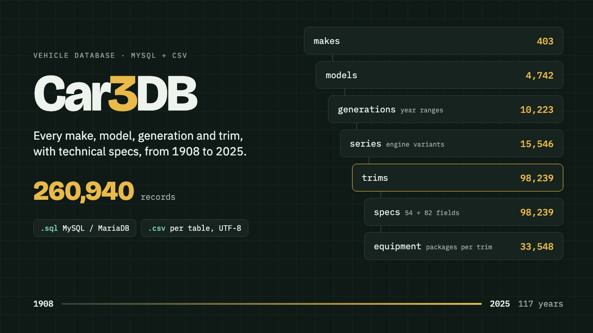

# Car3DB



**Car3DB: Car Make, Model & Trim Database (1908–2025), MySQL + CSV**

One ZIP: MySQL dump + 11 CSV files (one per table, plus flat vehicle and spec tables) + README with import steps.

**Price:** $49 · **Category:** Software · **Edition:** 2025-10

### [Get it on Gumroad →](https://kitwright.gumroad.com/l/enwrs?utm_source=github&utm_medium=readme&utm_campaign=car3db)

---

## The Most Comprehensive Automotive Database Available

**117 years of automotive history in one complete, structured database.**

Car3DB is the ultimate automotive data resource containing **260,940 verified records** spanning from the birth of the automobile industry in 1908 to modern vehicles in 2025. Whether you're building a car marketplace, comparison tool, vehicle history service, or automotive application, this database provides everything you need.

---


## 🚗 What's Inside

### Complete Automotive Hierarchy

- **403 Manufacturers** - From iconic classics to modern brands
- **4,742 Models** - Complete model lineups across all manufacturers
- **10,223 Generations** - Detailed generation information with year ranges
- **15,546 Series** - Engine variants and series specifications
- **98,239 Trim Levels** - Every trim configuration with detailed specs
- **98,239 Specification Sets** - Comprehensive technical data
- **33,548 Equipment Records** - Detailed equipment and feature lists


### 260,940 Total Database Records

Every record is carefully structured and normalized for immediate use in your projects.

---


## 📊 Detailed Specifications Include

### Engine & Performance

- Engine type (gasoline, diesel, hybrid, electric)
- Engine capacity (cm³)
- Power output (HP)
- Maximum torque (N⋅m)
- RPM ranges
- Cylinder configuration
- Number of cylinders
- Valves per cylinder
- Injection type
- Compression ratio
- 0-100 km/h acceleration time
- Maximum speed
- Engine code


### Dimensions & Measurements

- Length, width, height (mm)
- Wheelbase (mm)
- Front and rear track (mm)
- Ground clearance (mm)
- Turning circle (m)
- Wheel size specifications


### Weight & Capacity

- Curb weight (kg)
- Gross vehicle weight (kg)
- Payload capacity (kg)
- Trunk capacity (min/max in liters)
- Fuel tank capacity (liters)
- Number of seats
- Number of doors


### Fuel Economy

- City fuel consumption (l/100km)
- Highway fuel consumption (l/100km)
- Mixed fuel consumption (l/100km)
- Cruising range (km)
- Fuel octane rating


### Drivetrain & Transmission

- Gearbox type (manual, automatic, CVT, DCT)
- Number of gears
- Drive wheels (FWD, RWD, AWD, 4WD)


### Suspension & Brakes

- Front suspension type
- Rear suspension type
- Front brake type (disc, ventilated disc)
- Rear brake type


### Body & Classification

- Body type (sedan, SUV, coupe, hatchback, etc.)
- Vehicle class
- Steering wheel position
- Country of origin


---


## 📦 What You'll Receive

### One ZIP download (about 37 MB), two formats

**1. MySQL / MariaDB dump** (`sql/car3db.sql`)

- Creates all 8 tables with primary keys, indexes and 7 foreign keys
- utf8mb4, imports in under a minute (tested on MariaDB 10.11)
- Needs MySQL 8.0.16+ or MariaDB 10.2+


**2. CSV files** (`csv/`)

- One CSV per table (UTF-8, comma separated, header row)
- `vehicles.csv`: make, model, generation, series and trim in one table, no joins needed
- `specs_flat.csv`: the specs as 54 ready-to-filter columns (power, torque, weight, dimensions, consumption...)
- `specs_raw_flat.csv`: 82 columns with the original field labels, including EV battery and charging fields and CO2
- Opens in Excel, Google Sheets and Numbers; imports into PostgreSQL, SQLite (tested), MongoDB and analysis tools


**README.txt** with row counts, the schema, import commands and example queries.

### Database Structure

```
├── makes (403 records)
│   ├── id
│   └── name
│
├── models (4,742 records)
│   ├── id
│   ├── make_id
│   └── name
│
├── generations (10,223 records)
│   ├── id
│   ├── model_id
│   └── name
│
├── series (15,546 records)
│   ├── id
│   ├── model_id
│   ├── generation_id
│   └── name
│
├── trims (98,239 records)
│   ├── id
│   ├── series_id
│   └── name
│
├── specs (98,239 records, one per trim)
│   ├── trim_id
│   ├── specs_json      (54 normalized fields)
│   └── specs_raw_json  (82 fields, original labels)
│
└── equipments (33,548 records)
    ├── id
    ├── trim_id
    └── name (equipment / package name)

```


---


## 💼 Perfect For

### Web Applications

- **Car Marketplaces** - Build comprehensive vehicle listings
- **Comparison Tools** - Create detailed car comparison features
- **Automotive Portals** - Power your automotive content platform
- **Dealer Websites** - Enhance inventory management systems


### Mobile Apps

- **Car Finder Apps** - Help users discover their perfect vehicle
- **Specification Apps** - Provide detailed technical information
- **Vintage Car Apps** - Catalog classic and historic automobiles


### Business Solutions

- **Vehicle History Services** - Enrich your vehicle data
- **Insurance Platforms** - Accurate vehicle identification
- **Fleet Management** - Comprehensive vehicle specifications
- **Automotive APIs** - Build data services for developers


### Research & Analytics

- **Market Research** - Analyze automotive trends
- **Data Science Projects** - Rich dataset for ML/AI training
- **Academic Research** - Historical automotive evolution studies


---


## ✅ Why Choose Car3DB?

### ✓ Comprehensive Coverage

117 years of automotive history from vintage classics (1908) to the latest modern vehicles (2025).

### ✓ Verified & Accurate

All data is carefully curated and verified for accuracy. Consistent formatting across all entries.

### ✓ Ready to Use

Normalized database structure with proper relationships. Import and start using immediately.

### ✓ Multiple Formats

Choose between MySQL dump or CSV files based on your tech stack and preferences.

### ✓ Commercial License Included

Use in commercial projects, applications, websites, or services without restrictions.

### ✓ One-Time Payment

No subscriptions, no recurring fees. Pay once, own forever.

### ✓ Instant Access

Download immediately after purchase. No waiting, no approval process.

---


## 🔧 Technical Details

### Database Specifications

- **Total Size:** ~505 MB (MySQL dump)
- **Encoding:** UTF-8 (utf8mb4_general_ci)
- **Database Engine:** InnoDB
- **Format Version:** MySQL 5.7+ compatible
- **CSV Encoding:** UTF-8 with BOM


### System Requirements

- MySQL 5.7+ / MariaDB 10.2+ (for SQL import)
- Any database system (for CSV import)
- Minimum 1GB free disk space
- Text editor or database client


### Integration Examples

**MySQL:**

```
mysql -u username -p database_name < car3db_dump.sql

```


**PostgreSQL:** Import CSV files using COPY command

**MongoDB:** Convert and import JSON format

**SQLite:** Import CSV files using .import command

---


## 📈 Data Quality Standards

- ✓ Consistent field naming across all tables
- ✓ Standardized units (mm, kg, l, HP, km/h)
- ✓ Proper NULL handling for missing data
- ✓ Foreign key relationships maintained
- ✓ Indexed for optimal query performance
- ✓ No duplicate entries


---


## 🎯 Use Cases & Examples

### Example 1: Car Comparison Website

Pull specifications for multiple vehicles and display side-by-side comparisons with engine power, fuel economy, dimensions, and performance metrics.

### Example 2: Vintage Car Encyclopedia

Filter vehicles by year range (1908-1960) and create a comprehensive catalog of classic automobiles with historical data.

### Example 3: API Backend

Build a RESTful API serving automotive data to mobile apps, providing make/model/trim selection with detailed specifications.

### Example 4: Machine Learning Dataset

Train ML models on automotive trends, predict fuel efficiency, or analyze the evolution of engine technology over 117 years.

---


## 💰 Pricing & License

### One-Time Payment: $49

**What's Included:**

- ✅ Complete database access (260,940 records)
- ✅ MySQL dump format
- ✅ CSV format (all tables)
- ✅ Commercial use license
- ✅ Lifetime access to purchased version
- ✅ Instant download


**License Terms:**

- ✓ Use in commercial and personal projects
- ✓ Integrate into your applications and websites
- ✓ No attribution required (but appreciated!)
- ✗ Cannot resell the raw database
- ✗ Cannot redistribute as a standalone product


---


## 📥 Delivery & Download

After completing your purchase:

1. **Instant Access** - Download link provided immediately
2. **Single Download** - Link valid for one download (save your files securely!)
3. **File Formats** - Both MySQL (.sql) and CSV (.zip) formats included
4. **Email Receipt** - Confirmation with download instructions


**Important:** Your download link is valid for a single use. Please save the database files in a secure location after downloading.

---


## 🔐 Security & Privacy

- Secure payment processing through Gumroad
- No recurring charges or hidden fees
- Your personal information is protected
- Download link delivered via encrypted email


---


## ❓ Frequently Asked Questions

**Q: What years are covered?** A: The database spans from 1908 (early automotive era) to 2025 (latest modern vehicles), covering 117 years of automotive history.

**Q: Can I use this in a commercial project?** A: Yes! Commercial use is included in the license. Build applications, websites, or services without restrictions.

**Q: What database systems are supported?** A: MySQL/MariaDB (via .sql dump) and any system that supports CSV imports (PostgreSQL, SQLite, MongoDB, Excel, etc.).

**Q: Is the data accurate?** A: Yes. All data is carefully curated and verified. We maintain consistent formatting and standardized values across all records.

**Q: Do you provide support?** A: While this is a data product (not a service), feel free to reach out with questions about the database structure or import process.

**Q: Can I get updates?** A: This is a one-time purchase of the current database version. Future updates may be offered separately.

**Q: What if the download link expires?** A: The link is valid for one download. Please save your files securely. Contact us if you experience technical difficulties.

**Q: Can I see a sample of the data?** A: Yes! Visit [car3db.com](https://kitwright.gumroad.com/l/enwrs) to explore sample data and database structure.

---


## 🌟 Who Built This?

Car3DB was created by automotive enthusiasts and data professionals who understand the need for comprehensive, structured automotive data. We've spent countless hours collecting, verifying, and normalizing this dataset to provide the highest quality resource for developers and businesses.

---


## 🚀 Get Started Today

Stop searching for automotive data across multiple sources. Get everything you need in one complete, structured database.

**Download Car3DB now and start building your automotive application today!**

---


### 📞 Questions or Custom Requirements?

If you need custom data formats, additional fields, or have specific requirements, feel free to reach out after purchase.

---


**Car3DB - The Complete Automotive Database (1908-2025)** *260,940 Records • 403 Manufacturers • 98,239 Trims • Lifetime Access*

## 🎯 Keywords

`automotive database` `car database` `vehicle database` `car specifications` `automobile data` `mysql car database` `csv car database` `vehicle specs` `car models` `automotive data` `car API` `vehicle API` `car data download` `automotive dataset` `car information` `vehicle information` `classic cars` `vintage cars` `car history` `automobile history`

---


© 2025 Car3DB. All rights reserved.

---

**Keywords:** car database, vehicle database, automotive data, mysql, csv, car specs, make model trim, dataset

[← All Kitwright kits](../../README.md) · [Buy on Gumroad](https://kitwright.gumroad.com/l/enwrs?utm_source=github&utm_medium=readme_footer&utm_campaign=car3db)
