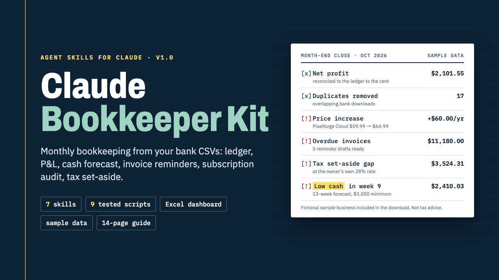

# Claude Bookkeeper Kit

**Claude Bookkeeper Kit: 7 Agent Skills for Monthly Bookkeeping**

One ZIP: 7 Claude Agent Skills (folder + upload-ready zip each), 9 Python scripts, a formula-only Excel dashboard, 6 months of sample data and a START-HERE PDF.

**Price:** $49 · **Category:** Business & Money · **Edition:** 2026-11

### [Get it on Gumroad →](https://kitwright.gumroad.com/l/claude-bookkeeper-kit?utm_source=github&utm_medium=readme&utm_campaign=claude-bookkeeper-kit)

---

**For freelancers, solo consultants and small online business owners who do their own books and dread month-end.** This kit turns Claude into a careful bookkeeping assistant: you bring your bank and card CSV exports, tested scripts do the math to the cent, and Claude handles the judgment calls with you.

---

### What you get

- **7 Claude Agent Skills**, each as a folder for Claude Code and as an upload-ready zip for Claude.ai and the Claude desktop app: month-end-close, bank-statement-categorizer, monthly-pnl, cash-flow-forecast, invoice-chaser, subscription-audit and tax-set-aside.
- **9 Python scripts** (standard library only) that do the arithmetic, so numbers are computed, not guessed. Every P&L is reconciled to the ledger to the cent.
- **Bookkeeping Dashboard.xlsx**: a formula-only workbook with 7 sheets (Start, Ledger, Categories, P&L, Cash, Invoices, Tax), no macros, plus a copy filled with the sample data.
- **A fictional sample business** with 6 months of transactions in 3 different bank export formats, 15 invoices and the expected results of a full month-end close, so you see it work before you use your own data.
- **START-HERE.pdf** (14 pages): install steps for Claude.ai, the desktop app and Claude Code, a 10-minute first run, your own data, privacy, FAQ and troubleshooting.
- **Templates**: settings file, rules file, a 25-category chart, invoice list, tax calendar, planned-items list and 3 reminder email templates.

### What it does each month

- Imports CSV exports from any bank or card: signed amounts or separate debit/credit columns, $1,234.56 or 1.234,56, (45.00) negatives, title lines above the header, most date formats.
- Removes duplicates from overlapping downloads, matches transfers between your accounts and matches refunds to the original purchase.
- Applies your rules; Claude suggests categories for unknown payees and you confirm, so each merchant is asked about once.
- Checks running balances and the statement balances you enter.
- Builds a P&L by month and category, a subscription audit (price increases, duplicate subscriptions, double charges, annual cost), invoice aging with friendly, firm and final reminder drafts, a tax set-aside figure from the rate you choose, and a 13-week cash forecast with a low-balance warning.

### How it works and how long it takes

1. Install: upload one zip in Claude (about 3 minutes) or copy one folder for Claude Code (about 2 minutes).
2. Try it: ask Claude to run the month-end close on the built-in sample data. First result in under 10 minutes.
3. Your data: download CSVs from your bank, run the close, confirm categories. First setup takes about 20 minutes; after that each month is one upload and one prompt.

### Who this is not for

- Businesses that need payroll, inventory, invoicing software or double-entry accounting. This is not a replacement for QuickBooks, Xero or an accountant.
- Anyone looking for tax filing or tax advice. The kit contains no tax rules for any country; you choose the set-aside rate.
- Anyone who can only get PDF statements. You need CSV exports from your bank.
- Anyone without access to Claude with Skills (see requirements below).

### Format and requirements

- This is a digital download: one ZIP file (about 1470 KB), not a printed book and not a web app. Everything is in the download: no extra logins, no license keys, no Discord. The skills run inside Claude, so you need a Claude account (below).
- **Claude.ai or the Claude desktop app:** a plan with Skills and the "Code execution and file creation" setting turned on. Anthropic's Help Center lists Skills on Free, Pro, Max, Ultra, Team and Enterprise plans (checked November 2026).
- **Or Claude Code** with Python 3.9 or newer on your computer.
- To open the .xlsx files: Excel, Google Sheets, Numbers or LibreOffice (optional; every number is also in CSV and Markdown files).
- Privacy: files you give Claude are processed by Anthropic under your Claude account's terms. The kit's scripts make no network calls and never connect to your bank.

### Updates

Free updates for this edition (v1.0, November 2026). Your own bookkeeping folder is never inside the kit, so installing an update cannot overwrite your settings or rules.

### Disclaimer

Independent product; not affiliated with, endorsed or sponsored by Anthropic. "Claude" is a trademark of Anthropic. Not tax, legal or accounting advice: check anything that matters with a qualified professional. The sample business and every name in it are fictional.

---

**Keywords:** bookkeeping, claude, claude skills, small business, freelancer, accounting, cash flow, ai tools

[← All Kitwright kits](../../README.md) · [Buy on Gumroad](https://kitwright.gumroad.com/l/claude-bookkeeper-kit?utm_source=github&utm_medium=readme_footer&utm_campaign=claude-bookkeeper-kit)
