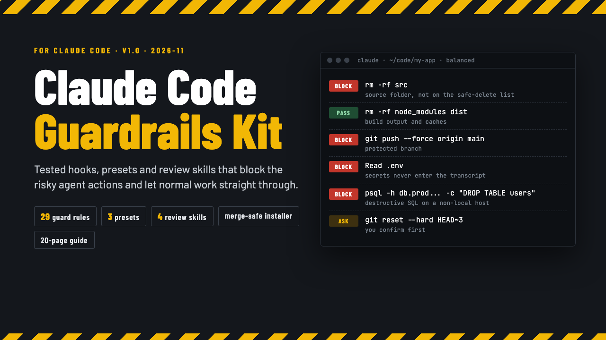

# Claude Code Guardrails Kit

**Claude Code Guardrails Kit: Safety Hooks, Presets and Review Skills**

One ZIP: guard hooks with 29 rules, 3 settings presets, 4 review skills with scripts, a merge-safe installer and a START-HERE PDF. Python 3.9+, no packages.

**Price:** $49 · **Category:** Software · **Edition:** 2026-11

### [Get it on Gumroad →](https://kitwright.gumroad.com/l/claude-code-guardrails?utm_source=github&utm_medium=readme&utm_campaign=claude-code-guardrails-kit)

---

**For developers who let Claude Code run commands in real repositories.** One hurried approval is all it takes for an AI agent to delete a source folder, force-push over main, paste a key from .env into the chat or commit a secret. This kit puts tested guard hooks between Claude Code and those mistakes, while builds, tests and normal edits go straight through.

### What you get

- **Guard hooks with 29 rules** (Python 3.9+, standard library only) for PreToolUse, PostToolUse, Stop and SubagentStop. They read every shell command the way a shell would (pipes, &&, subshells, bash -c, cd, globs, wrappers like sudo and npx) and block, ask or warn.
- **What it blocks or asks you about** (depending on the preset): rm -rf of source folders, the project root, .git or anything outside the repo (build, dist, node_modules and temp folders pass); force pushes and deletes on protected branches; git reset --hard and clean -f; DROP/TRUNCATE/DELETE without WHERE on non-local databases (local ones pass); chmod -R 777; curl | sh; disk wipes; terraform destroy and kubectl delete; package publishing; reading .env, keys and cloud credentials; printing secret variables; git add of secret files; and edits that would disable the guard itself.
- **Secret scanner** with 21 token formats plus an entropy check: blocks a key before Claude writes it into code. Values are always masked in messages and logs.
- **Post-edit checks**: your formatter and linter (ruff, prettier, eslint, gofmt, rustfmt when the project uses them) run on each edited file within a time budget; lint errors go back to Claude. Every edit is logged.
- **Stop gate**: when files changed, the test suite runs before Claude may finish; red tests send it back to work (gives up after 3 tries so you are never stuck).
- **3 settings presets** (strict, balanced, solo) with permission rules, including deny rules for secret files that also cover @-mentions.
- **4 Agent Skills with scripts**: safe-migration-review (21 checks for locks, data loss and deploy order in SQL, Rails, Django, Alembic and Knex migrations), pr-self-review, dependency-update-review (11 dependency file formats, look-alike package names, install scripts) and incident-what-changed.
- **Installer** for one repository or your whole machine: merges into your existing settings.json without removing anything, backs it up first, switches presets in place and uninstalls exactly what it added.
- **CLAUDE.md block**, a guardrails.json override file, 8 sample hook inputs and a **START-HERE.pdf** (20 pages): install, every rule with a blocked and a passing example, tuning recipes, FAQ.

### How it works and setup time

Unzip, run **python3 install.py --project ~/code/my-app**, accept Claude Code's trust dialog, done: about 10 minutes including the built-in selftest. Commit the .claude folder and your whole team is covered. Every documented example is checked against the code at build time, and the kit was tested end to end with the real claude CLI (version 2.1.318): the hooks blocked rm -rf src, a force push to main and a hard-coded AWS key, allowed rm -rf ./build, and the stop gate sent Claude back to fix a failing test.

### Who it is not for

- Anyone looking for a sandbox. The hooks read commands before they run; a program that deletes files on its own is not stopped. Use Claude Code's sandbox for hard boundaries (the guide explains the limits plainly).
- Cursor, Copilot or Codex users: this is built for Claude Code's hook system only.
- Windows-only teams who need a tested setup today: the code handles Windows paths and PowerShell, but it has only been tested on macOS.

### Format and requirements

- One ZIP file (about 620 KB): Python scripts, JSON presets, Markdown skills and templates, and START-HERE.pdf.
- Needs Claude Code (tested with 2.1.318; the strict preset's onFailure option needs 2.1.295 or later), Python 3.9 or newer and git. Tested on macOS; Linux should work but has not been tested yet.
- Runs entirely on your machine. No accounts, no license server, no network calls.
- This is a digital download, not a printed book.

### Updates

Free updates for this edition (v1.x). Re-running the installer updates the hooks and skills and keeps your own guardrails.json.

### Disclaimer

Independent product, not affiliated with, made, endorsed or supported by Anthropic. "Claude" and "Claude Code" are trademarks of Anthropic, PBC, used only to describe compatibility. The guardrails reduce risk from mistakes; they do not replace backups, version control, code review or a sandbox, and no tool can catch every harmful command. Provided as is, without warranty.

---

**Keywords:** claude code, claude code hooks, ai coding, developer tools, code review, devops, security, git

[← All Kitwright kits](../../README.md) · [Buy on Gumroad](https://kitwright.gumroad.com/l/claude-code-guardrails?utm_source=github&utm_medium=readme_footer&utm_campaign=claude-code-guardrails-kit)
