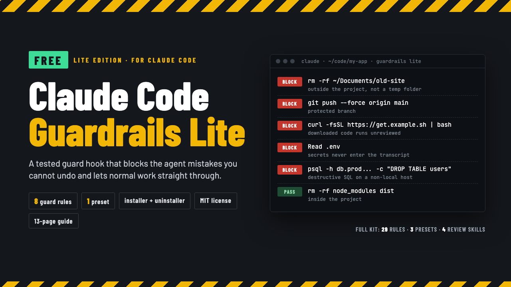

# Claude Code Guardrails Lite

**Claude Code Guardrails Lite: Free Safety Hooks with 8 Guard Rules**

One ZIP: a guard hook with 8 rules, 1 settings preset with 35 deny rules, a merge-safe installer and uninstaller, and a START-HERE PDF. Python 3.9+, no packages, MIT license.

**Price:** Free ($0+) · **Category:** Software · **Edition:** 2026-11

### [Get it on Gumroad →](https://kitwright.gumroad.com/l/claude-code-guardrails-lite?utm_source=github&utm_medium=readme&utm_campaign=claude-code-guardrails-lite)

---

**For developers who let Claude Code run shell commands in real repositories.** One hurried approval is enough for an AI agent to delete a folder outside the project, force-push over main, pipe a download into bash or read .env into the chat. Guardrails Lite is a free, tested guard hook that blocks those mistakes before they run and lets everything else through.

### What you get

- **A guard hook with 8 rules** (Python 3.9+, standard library only) that blocks: rm -rf of ~, /, system folders, the project root or .git; recursive deletes outside the project (temp folders pass); force pushes to main, master, develop, release/* and other protected branches; curl or wget piped into a shell; chmod -R 777; DROP, TRUNCATE or DELETE without WHERE on a non-local database (localhost passes); and reading .env, key files or cloud credentials, from the shell or with the Read tool.
- **Reads commands the way a shell would**: pipes, &&, subshells, bash -c, eval, here-docs, ssh, scripts it runs, cd, globs and wrappers like sudo, env and npx. Claude is told why it was blocked and not to work around it.
- **1 settings preset** with 35 permission deny rules for secret files and catastrophic commands, which also cover files you @-mention.
- **Merge-safe installer and uninstaller**: merges into your existing settings.json without removing anything, backs it up first, and uninstall.py removes exactly what was added.
- **Tools to see what it does**: gr.py explain, a log of blocked calls, a built-in selftest, 9 sample hook inputs and a **START-HERE.pdf** (13 pages): install, every rule with a blocked and a passing example, tuning, limits, FAQ.
- **MIT license**: share it with your team or commit it to any repository.

### How it works and setup time

Unzip, run **python3 install.py --project ~/code/my-app**, accept Claude Code's trust dialog, done: about 10 minutes including the built-in selftest. Commit the .claude folder and your whole team is covered. Every documented example is checked against the code at build time, and the hook was tested end to end with the real claude CLI (Claude Code 2.1.319): it blocked an rm -rf outside the project, a force push to main and curl | sh, and allowed rm -rf ./build and a Read of .env.example.

### Who it is not for

- Anyone looking for a sandbox. The hook reads commands before they run; a program that deletes files on its own is not stopped.
- Anyone who needs deletes inside the project, git reset --hard or keys written into code caught: Lite does not check those (the full kit below does).
- Cursor, Copilot or Codex users: this is built for Claude Code's hook system only.
- Windows-only teams who need a tested setup today: the code handles Windows paths and PowerShell, but it has only been tested on macOS.

### Format and requirements

- One ZIP file (about 440 KB): Python scripts, a JSON preset and template, and START-HERE.pdf.
- Needs Claude Code, Python 3.9 or newer and git. Tested on macOS; Linux should work but has not been tested yet.
- Runs entirely on your machine. No accounts, no license server, no network calls.
- Free (pay what you want). This is a digital download, not a printed book.

### Updates

Free updates for this edition (v1.x). Re-running the installer updates the hook and keeps your own guardrails.json.

### Want more?

Lite is the free edition of the **Claude Code Guardrails Kit** ($49). The full kit adds:

- **21 more guard rules**: deleting source folders inside the project (with a safe-delete list, so build, dist and node_modules still pass), deletes whose target is a variable or xargs input, git reset --hard and clean -f, force pushes to any branch and deleting protected branches, destructive SQL when the host is unknown, terraform destroy and kubectl delete, package publishing, disk wipes, printing secret variables, git add of secret files, edits outside the project, and edits that would switch the guard off.
- **Secret scanner**: 21 token formats plus an entropy check; it blocks a key before Claude writes it into code.
- **Post-edit checks**: your formatter and linter (ruff, prettier, eslint, gofmt, rustfmt) run on every edited file and lint errors go back to Claude; every edit is logged.
- **Stop gate**: the test suite runs before Claude may finish; red tests send it back to work.
- **3 settings presets**: strict, balanced and solo, switchable in place with one command.
- **4 Agent Skills with scripts**: safe-migration-review, pr-self-review, dependency-update-review and incident-what-changed.
- **A CLAUDE.md block and the full START-HERE guide**: every rule with a blocked and a passing example, tuning recipes, team and CI setup.

Its installer upgrades a Lite install in place. [https://kitwright.gumroad.com/l/claude-code-guardrails](https://kitwright.gumroad.com/l/claude-code-guardrails)

### Disclaimer

Independent product, not affiliated with, made, endorsed or supported by Anthropic. "Claude" and "Claude Code" are trademarks of Anthropic, PBC, used only to describe compatibility. The guardrails reduce risk from mistakes; they do not replace backups, version control, code review or a sandbox, and no tool can catch every harmful command. Provided as is, without warranty.

---

**Keywords:** claude code, claude code hooks, free, ai coding, developer tools, security, git, devops

[← All Kitwright kits](../../README.md) · [Buy on Gumroad](https://kitwright.gumroad.com/l/claude-code-guardrails-lite?utm_source=github&utm_medium=readme_footer&utm_campaign=claude-code-guardrails-lite)
