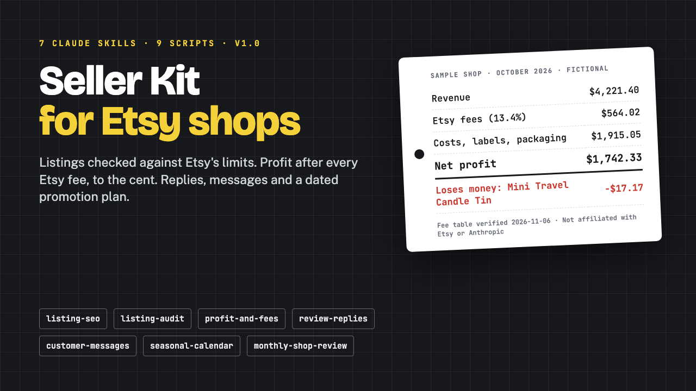

# Seller Kit for Etsy Shops

**Seller Kit for Etsy Shops: 7 Claude Skills for Listings, Fees and Profit**

One ZIP: 7 Claude Agent Skills (folder + upload-ready zip each), 9 Python scripts, one editable Etsy fee table, 17 message templates, a sample shop and a START-HERE PDF.

**Price:** $39 · **Category:** Business & Money · **Edition:** 2026-11

### [Get it on Gumroad →](https://kitwright.gumroad.com/l/claude-etsy-seller-kit?utm_source=github&utm_medium=readme&utm_campaign=claude-etsy-seller-kit)

---

**For Etsy sellers who want listings that follow Etsy's rules and a clear number for what they actually keep after every Etsy fee.** This kit turns Claude into a careful shop assistant: tested scripts check your titles and tags against Etsy's published limits and compute fees to the cent from Etsy's own CSV downloads, while Claude writes the drafts and explains the results.

---

### What you get

- **7 Claude Agent Skills**, each as a folder for Claude Code and as an upload-ready zip for Claude.ai and the Claude desktop app: monthly-shop-review, listing-seo, listing-audit, profit-and-fees, review-replies, customer-messages and seasonal-calendar.
- **9 Python scripts** (standard library only): a listing validator, a shop-wide listing audit, profit and fees from Etsy's Orders and Order Items CSVs, a break-even price calculator, review triage, message drafting, a 12-month promotion calendar and the monthly review that runs them all.
- **One editable fee table** (etsy_fees.ini): transaction, listing, payment processing for 64 bank-account countries, Offsite Ads with its USD 100 cap, regulatory operating fees, currency conversion, VAT on fees and refund credits, each with its Etsy Help Center source, verified November 2026.
- **17 message templates in 3 tones**: 11 buyer messages (late shipping, stalled tracking, damaged or wrong item, custom order quote and proof, refunds, cancellation, address change, low-review follow-up) and 6 public review replies.
- **A fictional sample shop**: 3 months of Etsy-format downloads (134 orders, 18 listings, 22 reviews) with planted problems and the expected results, so you see everything work before you use your own shop.
- **START-HERE.pdf** (14 pages): install steps for Claude.ai, the desktop app and Claude Code, a 10-minute first run, your own shop, fee and listing rules, privacy, FAQ and troubleshooting.

### What it does

- Drafts a title, 13 tags and a description from your product facts and checks them: 140-character titles, the four symbols Etsy allows once, 13 tags of up to 20 characters, plural and reordered duplicates, tags that repeat an attribute, subjective or shipping words.
- Audits your whole listings download: unused tag slots, overlapping listings, few photos, missing attributes, and prices below break-even after fees, label and packaging.
- Computes net profit per order, product and month, including refunds and the fee credits Etsy gives back, and flags products that lose money overall or whenever they are ordered alone.
- Sorts your reviews, counts the 100-day reply window and puts the private message before the public reply (Etsy locks a review once you reply).
- Builds a dated promotion plan for the US, UK, Canada or Australia with prep dates, sale windows and last order dates, as CSV and a calendar file.

### How it works and how long it takes

1. Install: upload one zip in Claude (about 3 minutes) or copy one folder for Claude Code (about 2 minutes).
2. Try it: ask Claude to run the monthly review on the built-in sample shop. First result in under 10 minutes.
3. Your shop: download your Orders, Order Items and listings CSVs from Shop Manager, fill in your settings and product costs once (about 20 minutes), then each month is one prompt.

### Who this is not for

- Anyone looking for keyword search volumes or rank tracking. The kit checks rules and structure; it has no Etsy search data.
- Anyone who wants posting or messaging automated. Nothing is posted to your shop or sent to buyers; you copy the drafts yourself.
- Anyone looking for tax filing or bookkeeping software. Etsy Ads, subscriptions and overheads are not in the profit figures.
- Anyone without access to Claude with Skills (see requirements below).

### Format and requirements

- This is a digital download: one ZIP file (about 2130 KB), not a printed book and not a web app. Everything is in the download: no logins, no license keys, no Etsy API access, no Discord.
- **Claude.ai or the Claude desktop app:** a plan with Skills and the "Code execution and file creation" setting turned on. Anthropic's Help Center lists Skills on Free, Pro, Max, Ultra, Team and Enterprise plans (checked November 2026).
- **Or Claude Code** with Python 3.9 or newer on your computer.
- Your files: Etsy's own CSV downloads (Shop Manager > Settings > Options > Download Data). Outputs are Markdown, CSV and a .ics calendar file.
- Privacy: files you give Claude are processed by Anthropic under your Claude account's terms. The kit's scripts make no network calls.

### Updates

Free updates for this edition (v1.0, November 2026). Etsy changes fees from time to time: every fee is in one file you can edit yourself, and your own settings folder is never inside the kit, so an update cannot overwrite it.

### Disclaimer

Independent product; not affiliated with, endorsed or sponsored by Etsy, Inc. or Anthropic. "Etsy" is a trademark of Etsy, Inc.; "Claude" is a trademark of Anthropic. Fees change: check Etsy's fee page before relying on a number. Not tax, legal or accounting advice. The sample shop and every name in it are fictional.

---

**Keywords:** etsy, etsy seo, etsy seller, etsy fees, etsy shop, claude, claude skills, ai tools

[← All Kitwright kits](../../README.md) · [Buy on Gumroad](https://kitwright.gumroad.com/l/claude-etsy-seller-kit?utm_source=github&utm_medium=readme_footer&utm_campaign=claude-etsy-seller-kit)
