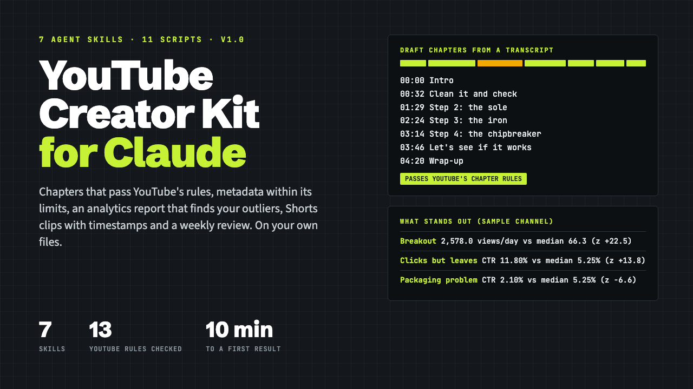

# Claude YouTube Creator Kit

**Claude YouTube Creator Kit: 7 Agent Skills for Solo YouTubers**

One ZIP: 7 Claude Agent Skills (folder + upload-ready zip each), 11 Python scripts, a fictional sample channel with expected results, templates and a START-HERE PDF.

**Price:** $49 · **Category:** Business & Money · **Edition:** 2026-11

### [Get it on Gumroad →](https://kitwright.gumroad.com/l/claude-youtube-creator-kit?utm_source=github&utm_medium=readme&utm_campaign=claude-youtube-creator-kit)

---

**For solo YouTube creators who do their own chapters, descriptions, analytics and planning.** This kit turns Claude into an assistant that works on your own files: tested scripts parse your transcripts and YouTube Studio exports and check everything against YouTube's published rules, and Claude does the writing and judgment with you.

---

### What you get

- **7 Claude Agent Skills**, each as a folder for Claude Code and as an upload-ready zip for Claude.ai and the Claude desktop app: weekly-review, transcript-to-chapters, title-and-thumbnail-lab, description-and-tags, analytics-report, repurpose and content-calendar.
- **11 Python scripts** (standard library only, nothing to install) that do the counting and checking, so numbers and limits are computed, not guessed.
- **Chapters from any transcript** (SRT, WebVTT including auto-captions, SBV, or text copied from "Show transcript"), drafted where topics change and checked against YouTube's chapter rules: first at 00:00, at least 3, each at least 10 seconds.
- **An analytics report** from your YouTube Studio export: views per day, click-through rate, average percentage viewed and subscribers per 1,000 views for every video, outliers found with a robust statistic (long-form and Shorts compared separately), and a comparison with the period before.
- **Title, description, tag and hashtag checks** that count characters the way YouTube documents it (100-character titles, 5,000-character descriptions, 500-character tags with commas and quotes, the 60-hashtag rule), plus YouTube's own title tips.
- **Shorts clip candidates** with in and out times to a tenth of a second, a newsletter and post brief, and a fact check that flags any number in your drafts that the video never says.
- **A content calendar** from your topic list: publish dates on your weekdays, production steps dated backwards, deadlines, series order and a weekly hours check, as a CSV for Google Sheets and an .ics file for your calendar.
- **An A/B test log** for YouTube's title and thumbnail tests, with a two-proportion z-test for manual before-and-after swaps.
- **A fictional sample channel** with 3 transcripts, 2 Studio exports, 16 video ideas and 4 tests, plus the exact expected results of a full weekly review.
- **START-HERE.pdf** (13 pages): install steps for Claude.ai, the desktop app and Claude Code, a 10-minute first run, your own channel, the weekly routine, every YouTube rule the kit checks with its source and date, FAQ and troubleshooting.
- **Templates**: channel settings, topic list, test log, description layout and a calendar CSV.

### How it works and how long it takes

1. Install: upload one zip in Claude (about 3 minutes) or copy the skill folders for Claude Code (about 2 minutes).
2. Try it: ask Claude to run the weekly review on the sample channel. First result in under 10 minutes.
3. Your channel: export your analytics from YouTube Studio, download a transcript, fill in one settings file (about 20 minutes once). After that the weekly review takes about 30 minutes, including your decisions.

### Who this is not for

- Anyone looking for guaranteed views, subscribers or income. The kit reports what your own data shows; it promises nothing.
- Anyone who wants videos edited or uploaded for them. You paste the results into YouTube Studio yourself; nothing connects to your YouTube account.
- Channels that only publish Shorts and need chapters or title tests: YouTube offers neither for Shorts.
- Anyone without access to Claude with Skills (see requirements below).

### Format and requirements

- This is a digital download: one ZIP file (about 1800 KB), not a printed book and not a web app. Everything is in the download: no extra logins, no license keys, no Discord. The skills run inside Claude, so you need a Claude account.
- **Claude.ai or the Claude desktop app:** a plan with Skills and the "Code execution and file creation" setting turned on. Anthropic's Help Center lists Skills on Free, Pro, Max, Ultra, Team and Enterprise plans; its developer documentation lists custom Skills on the paid plans (both checked November 2026).
- **Or Claude Code** with Python 3.9 or newer on your computer.
- Your files: transcripts as .srt, .vtt, .sbv or timestamped .txt; analytics as the YouTube Studio CSV export. Outputs are Markdown, CSV and .ics files that open anywhere.
- Language: the checks and analytics work in any language; chapter and clip detection is tuned for English speech.
- Privacy: files you give Claude are processed by Anthropic under your Claude account's terms. The kit's scripts make no network calls and never connect to YouTube.

### Updates

Free updates for this edition (v1.0, November 2026). Your own channel folder is never inside the kit, so installing an update cannot overwrite your settings, ideas or test log. Every YouTube rule in the kit carries the date it was checked.

### Disclaimer

Independent product; not affiliated with, endorsed or sponsored by YouTube, Google or Anthropic. "YouTube" is a trademark of Google LLC and "Claude" is a trademark of Anthropic. No promise of views, subscribers, watch time or income. Not legal advice on sponsorship or affiliate disclosure rules. The sample channel and every name in it are fictional.

---

**Keywords:** youtube, claude, claude skills, youtube creator, youtube chapters, youtube analytics, content calendar, ai tools

[← All Kitwright kits](../../README.md) · [Buy on Gumroad](https://kitwright.gumroad.com/l/claude-youtube-creator-kit?utm_source=github&utm_medium=readme_footer&utm_campaign=claude-youtube-creator-kit)
