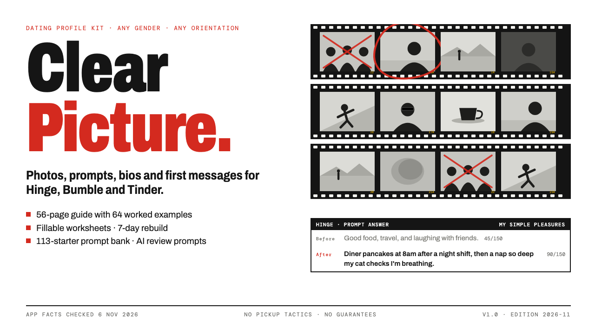

# Clear Picture

**Clear Picture: Dating Profile Kit for Hinge, Bumble & Tinder (2026)**

56-page guide, 12-page fillable worksheets, 113-starter prompt bank (PDF + CSV), AI review prompts and START-HERE. App facts checked Nov 2026.

**Price:** $29 · **Category:** Self Improvement · **Edition:** 2026-11

### [Get it on Gumroad →](https://kitwright.gumroad.com/l/clear-picture?utm_source=github&utm_medium=readme&utm_campaign=dating-profile-kit)

---

**For anyone on Hinge, Bumble or Tinder, of any gender and orientation, whose profile gets few matches, the wrong matches, or conversations that go nowhere.** Most profiles fall short in two places: a lead photo that does not land, and words that are generic. This kit shows you, step by step, how to make yours clear, honest, specific and easy to reply to.

It is a practical, respectful system: a photo plan, prompt and bio frameworks with 64 worked examples (53 before-and-after pairs, plus voice scripts, polls and notes) from 17 very different (fictional) people, first messages tied to the other person's profile, and a 7-day rebuild. No pickup tactics, no scripts to pressure anyone, no promises of matches.

### What you get

- **The guide (56-page PDF).** How profiles get read; the three apps' current rules and limits, checked on their own help pages on 6 November 2026; a six-role photo plan with lighting, framing and distance diagrams (diagrams, not model photos); six prompt frameworks; four bio formulas; voice prompts, polls and Hinge Match Notes; first messages; moving to a date; safety and consent; the 15-point scorecard with two complete worked profiles; the 7-day rebuild and a two-week check-in table.
- **Fillable worksheets (12-page PDF, 454 fields).** Type into them on screen or print them: what you want, your raw-material inventory, photo shot list, photo selection grid, prompt drafts, bio and Match Note, opener builder, date ask and safety plan, scorecard, and a two-week results log.
- **Prompt bank (11-page PDF plus CSV).** 113 answer starters in 13 themes, from everyday life to faith, kids, sobriety, identity and starting over at 50+, each tagged with its framework.
- **AI review prompts (plain text).** Paste into Claude, ChatGPT or a similar assistant to have your own profile scored against the scorecard, criterion by criterion, with your top three fixes. Plus a photo review, a prompt and bio coach that interviews you for specifics (it does not write your profile for you), an opener check and a two-week check-in.
- **START-HERE.pdf**, which gets you to a scored profile and your three biggest fixes in about ten minutes.

### What makes it different

- **Current facts, honestly labelled.** Bumble ended Opening Moves and "women message first" in August 2026; Hinge and Tinder removed in-app video calls; Face Check is now required for new Tinder users in many countries. Every fact has a source and a status. Where a number is not official (Hinge's 150-character prompt limit, for example, appears on no official Hinge page), the guide says so.
- **Every example fits the app.** All 64 examples were checked against the character limit for their app and field.
- **Research cited with its strength.** Studies on profile photos, lens distortion, first impressions and online-dating behaviour are cited with links to the original papers, with a plain note on how strong each one is.
- **Inclusive by design.** Examples include straight, gay, lesbian, bisexual, queer and asexual people, a trans woman, a trans man and nonbinary people, ages 24 to 63, parents, a widower, a wheelchair user, a practising Muslim, and someone who wants something casual. Safety advice covers sextortion and romance scams, and lists helplines in the US, UK, Ireland and Australia.

### How it works

1. Open START-HERE.pdf and score your current profile (10 minutes, with or without an AI assistant).
2. Do the 30-minute fix, or the 7-day rebuild: seven sessions of 20 to 90 minutes, each with a worksheet.
3. Publish, use the profile for two weeks, then change one thing at a time using the check-in table.

### Who it is not for

- Anyone looking for pickup lines, tricks or ways to pressure someone. You will not find them here.
- Anyone who wants a done-for-you profile. The kit gives you frameworks, examples and reviews; you write your own words (Hinge's Terms require that anyway).
- People wanting relationship therapy or help with an existing relationship.

### Format and requirements

- One ZIP file (about 3 MB) containing 4 PDFs (US Letter, print-friendly), a CSV file, and plain-text prompt files.
- Needs a PDF reader. To type into the worksheets, use Adobe Acrobat Reader (free), Preview on a Mac, or a browser such as Chrome or Edge. The AI review is optional and works with any AI chat assistant you already use.
- Works offline. No account, no login, no community to join.
- This is a digital download, not a printed book.

### Updates

Version 1.0, edition 2026-11. Free updates for this edition. Apps change their features often; the guide says what to re-check in your app, and every app fact carries the date it was checked.

### Disclaimer

Independent product. Not affiliated with, endorsed by or sponsored by Hinge, Bumble, Tinder, Match Group, Bumble Inc., Anthropic, OpenAI or any other company named. All trademarks belong to their owners. The worked examples are fictional. This is general information, not legal, medical or therapy advice, and it does not guarantee matches, dates or relationships.

---

**Keywords:** dating profile, hinge, bumble, tinder, dating app, online dating, dating tips, profile photos

[← All Kitwright kits](../../README.md) · [Buy on Gumroad](https://kitwright.gumroad.com/l/clear-picture?utm_source=github&utm_medium=readme_footer&utm_campaign=dating-profile-kit)
