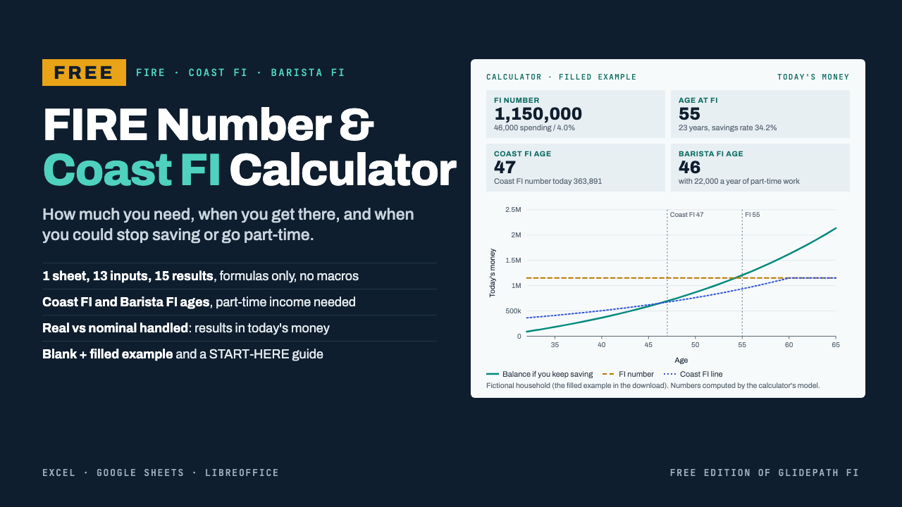

# Free FIRE Number & Coast FI Calculator Spreadsheet

**Free FIRE Number & Coast FI Calculator Spreadsheet**

Free ZIP: a one-sheet FIRE number, Coast FI and Barista FI calculator for Excel, Google Sheets and LibreOffice (blank + filled example, formulas only, no macros) and a 4-page START-HERE PDF. Pay what you want.

**Price:** Free ($0+) · **Category:** Business & Money · **Edition:** 2026-11

### [Get it on Gumroad →](https://kitwright.gumroad.com/l/coast-fi-calculator?utm_source=github&utm_medium=readme&utm_campaign=fire-coast-fi-calculator)

---

For anyone working toward financial independence who wants three answers without building a spreadsheet: **how much do I need, when do I get there, and when could I stop saving or go part-time?** Type 13 numbers on one sheet and read your FI number, your age at FI, your Coast FI age and the part-time income that would let you leave full-time work. It is free; pay what you want if it helps you.

### What you get

- **FIRE and Coast FI Calculator.xlsx**: one sheet, formulas only, no macros.

  - 13 yellow input cells, each with a note on how to choose it. The market assumptions come pre-filled.
  - 15 results:

    - FI number, in today's money and in future money;
    - years and age to FI, and your balance at your target age;
    - Coast FI number and Coast FI age;
    - Barista FI number and age;
    - the part-time income needed today and at your target age.

  - 4 key-result tiles and 1 chart: your balance, the FI number and the Coast FI line by age.
  - A status banner with 8 input checks and 3 warnings, so a typo shows up as a message, not as a wrong answer.
  - The 75-year year-by-year table behind every result, on the same sheet.

- **FIRE and Coast FI Calculator (example).xlsx**: the same sheet filled in for a fictional 32-year-old, so you can see finished results first.
- **START-HERE.pdf** (4 pages): how to open the file in Excel, Google Sheets or LibreOffice, what to type in each cell, how every result is calculated, a worked example and troubleshooting.

### How it works

1. Unzip the download and open the blank workbook in Excel or LibreOffice, or upload it to Google Sheets (steps in START-HERE).
2. Type your ages, invested assets, take-home pay, spending, part-time income and expected return into the yellow cells. This takes about 5 minutes.
3. When the banner turns teal, read your results. Change any number and everything updates.

Real vs nominal is handled for you. You type nominal returns and inflation, the way they are usually quoted. The sheet converts them to an exact real return after fees, and every result is in today's money unless its label says future money.

The workbook was recalculated headless in LibreOffice, with both English and German number formats. Its results were compared cell by cell with an independent Python implementation on 200 random input sets and 43 edge cases, such as already FI, zero savings, zero or negative real returns and withdrawal-rate limits. It uses the same formulas as our paid Glidepath FI planner. A test runs both on the same inputs and checks that they give the same FI, Coast FI and Barista FI results.

### Who it is not for

- Anyone who needs to know whether the money lasts through retirement. This sheet stops at the date you reach FI: no withdrawals, pensions, taxes or market ups and downs.
- People who want Monte Carlo probabilities.
- Anyone looking for investment picks, a budgeting app or personal advice.

### Format and requirements

- One ZIP file containing 2 .xlsx workbooks (blank and filled example), a START-HERE PDF and a licence. This is a digital download, not a printed book.
- Works with:

  - Microsoft Excel 2010 or later (Windows or Mac) or Excel for the web;
  - Google Sheets (free Google account);
  - LibreOffice Calc 7 or later.

- The sheet uses only 10 standard spreadsheet functions that Excel, Google Sheets and LibreOffice all document. The automated recalculation tests ran in LibreOffice. Apple Numbers was not tested.
- Works offline. No macros, add-ins or logins.
- Any currency: amounts are plain numbers.
- Free for personal use. You may share the unmodified files with credit. Resale is not allowed.

### Updates

Free updates for this edition (2026-11). Updated files appear in your Gumroad library.

### Want the full plan?

[Glidepath FI](https://kitwright.gumroad.com/l/glidepath-fi) is our paid planner, built on the same formulas. It also answers whether the money lasts once you stop:

- 75-year projection into retirement: withdrawals, pension and part-time income, money-runs-out age
- 4 withdrawal strategies: 4% rule, constant %, Guyton-Klinger-style guardrails, spending target
- Sequence-of-returns stress test: an editable 60-year return sequence replayed 4 ways
- Sensitivity grid: years to FI for 14 savings rates x 8 returns
- 120-row net worth tracker, 10 sheets, 6 charts, 21 checks
- 25-page methodology PDF with 3 worked households and sources

### Disclaimer

Educational tool, not financial, investment, tax or legal advice. Projections are not guarantees: returns, inflation, taxes and lifespans will differ from any assumption. The example household is fictional. Not affiliated with Microsoft, Google or The Document Foundation.

---

**Keywords:** fire, coast fi, fire calculator, barista fi, retirement, spreadsheet, personal finance, free

[← All Kitwright kits](../../README.md) · [Buy on Gumroad](https://kitwright.gumroad.com/l/coast-fi-calculator?utm_source=github&utm_medium=readme_footer&utm_campaign=fire-coast-fi-calculator)
