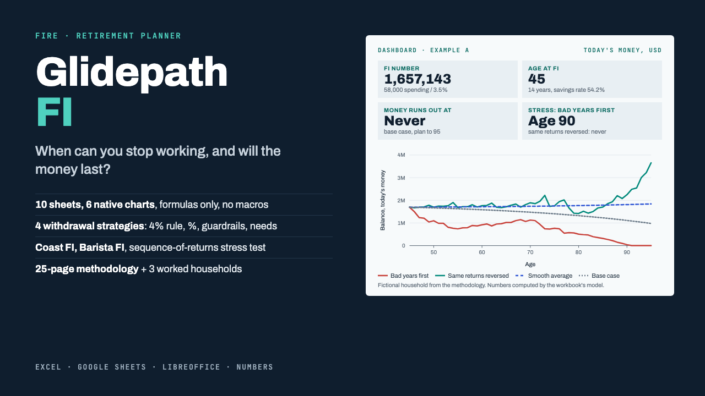

# Glidepath FI

**Glidepath FI: FIRE & Retirement Planner Spreadsheet (Excel + Google Sheets)**

One ZIP: a formula-only FIRE and retirement workbook (10 sheets, 6 charts, no macros) for Excel, Google Sheets, LibreOffice and Numbers, a 25-page methodology PDF and a START-HERE PDF.

**Price:** $29 · **Category:** Business & Money · **Edition:** 2026-11

### [Get it on Gumroad →](https://kitwright.gumroad.com/l/glidepath-fi?utm_source=github&utm_medium=readme&utm_campaign=fire-retirement-planner)

---

For anyone working toward financial independence or early retirement who wants to know two things: **when can I stop working, and will the money last?** Most FIRE calculators give one number from assumptions you cannot see. Glidepath FI puts every assumption on one sheet and every year of the plan in plain view, then stress-tests it.

### What you get

- **Glidepath FI Planner.xlsx**: one workbook with 10 sheets. Formulas only, no macros.

  - **Dashboard**: status banner, 8 result tiles and 6 native charts.
  - **Inputs**: all 24 assumptions with a note on how to choose each. Four scenario columns: your plan plus 3 worked examples, switched with one dropdown.
  - **Projection**: 75 years, one row per year: contributions, growth, withdrawals, pension and part-time income. Balances in today's money and future money.
  - **Stress Test**: a sequence-of-returns test. An editable 60-year return sequence is replayed 4 ways: bad years first, the same returns reversed, a smooth average, and your base case.
  - **Sensitivity**: years to FI and age at FI for 14 savings rates x 8 returns.
  - **Net Worth**: a 120-row tracker for assets, debts, net worth and FI progress.
  - **Results** and **Checks**: every output in one list; 13 input checks, 5 warnings and 3 self-checks of the model's own arithmetic.

- **Calculations included**: FI number and years to FI; real vs nominal returns after inflation and fees; Coast FI; Barista FI; and 4 withdrawal strategies:

  - constant real (the 4% rule);
  - constant percentage;
  - Guyton-Klinger-style guardrails;
  - spending target, net of pension and part-time income.

- **Glidepath FI Methodology.pdf** (25 pages):

  - every formula and timing rule;
  - the 4% rule's origins and limits (Bengen 1994, the Trinity study 1998, Pfau 2010, Guyton and Klinger 2006);
  - how to choose returns, inflation, fees and withdrawal rate, with sourced reference figures verified November 2026;
  - three fictional households worked from first input to final balance, each with what-if comparisons.

- **START-HERE.pdf** (4 pages): exact steps to open the file in each program and get your first result.

### How it works

1. Open the workbook in Excel, or upload it to Google Sheets (steps in START-HERE).
2. Type your numbers into the yellow cells of one column: ages, invested assets, take-home pay, spending, expected returns, inflation, fees and withdrawal rate. This takes about 10 minutes.
3. Read the Dashboard: your FI number, the age you reach it, whether the money lasts to your plan-to age, and what happens if your retirement starts with a bad decade.

The three worked examples from the PDF are built in. Switch the scenario dropdown to see the same numbers as the PDF, then switch back; your own inputs stay untouched.

The workbook was recalculated headless in LibreOffice. Its numbers were compared with an independent Python implementation of the model on 300 randomized input sets and 42 edge cases (zero returns, already FI, negative real returns, invalid ages and more).

### Who it is not for

- People who want Monte Carlo probabilities. This is a transparent deterministic model with an explicit stress test.
- Anyone who needs a country-specific tax calculator. The model is country-neutral, and taxes enter through the spending and savings figures you type.
- Anyone looking for investment picks, a budgeting app or personal advice.

### Format and requirements

- One ZIP file containing 1 .xlsx workbook, 2 PDFs, a changelog and a licence. This is a digital download, not a printed book.
- Works with:

  - Microsoft Excel 2010 or later (Windows or Mac) or Excel for the web;
  - Google Sheets (free Google account);
  - LibreOffice Calc 7 or later;
  - Apple Numbers.

- Works offline. No macros, add-ins or logins.
- Uses only 17 common spreadsheet functions that Excel, Google Sheets, LibreOffice and Numbers all document. Automated recalculation tests ran in LibreOffice. In Numbers, dropdown lists may become plain cells: type the option name or 1-4.
- Any currency: amounts are plain numbers with a currency label you choose.

### Updates

Free updates for this edition (2026-11). Updated files appear in your Gumroad library.

### Disclaimer

Educational tool, not financial, investment, tax or legal advice. Projections are not guarantees: returns, inflation, taxes and lifespans will differ from any assumption. The example households are fictional. Not affiliated with Microsoft, Google, Apple, The Document Foundation, or any author or institution cited in the methodology.

---

**Keywords:** fire, retirement, fire calculator, financial freedom, spreadsheet, google sheets, excel template, personal finance

[← All Kitwright kits](../../README.md) · [Buy on Gumroad](https://kitwright.gumroad.com/l/glidepath-fi?utm_source=github&utm_medium=readme_footer&utm_campaign=fire-retirement-planner)
