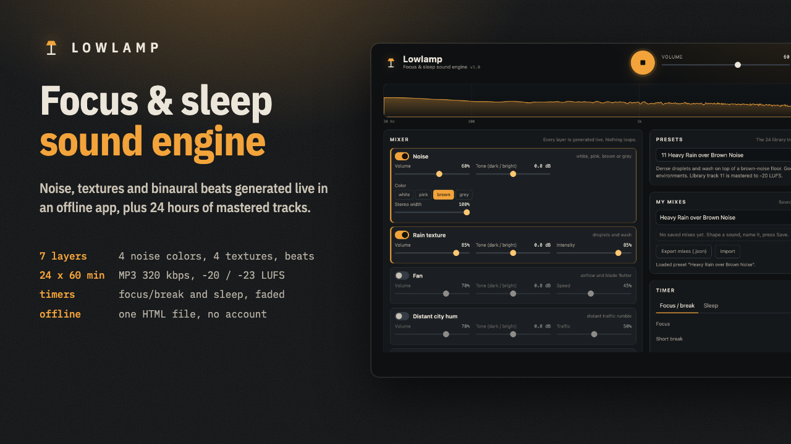

# Lowlamp

**Lowlamp: Focus & Sleep Sound Engine + 24 Hours of Mastered Noise Tracks**

Offline sound engine web app (live noise, rain/fan/city/ocean, binaural, focus and sleep timers) + 24 one-hour MP3 tracks (320 kbps) + 2 PDF guides.

**Price:** $29 · **Category:** Audio · **Edition:** 2026-11

### [Get it on Gumroad →](https://kitwright.gumroad.com/l/lowlamp?utm_source=github&utm_medium=readme&utm_campaign=focus-sound-engine)

---

Lowlamp is for people who work or sleep better with steady sound and are tired of apps that need an account, a subscription and an internet connection, or of noise videos that loop every few minutes. You get a sound engine that generates noise live on your own computer, plus a full day of mastered tracks for your phone.

### What you get

- **Lowlamp.html, an offline sound engine app.** One file you double-click; it runs in your browser with no install, no login and no network. Seven layers generated in real time, never looped: white, pink, brown and grey noise; rain, fan, distant-city and ocean-swell textures built from filtered noise; a binaural-beat layer (carrier and beat frequency) and an isochronic pulse. Every layer has its own volume and tone (tilt EQ) control.
- **Focus/break timer** (Pomodoro-style, 25/5 by default, all lengths adjustable) with fade-in, fade-out and a soft chime, and a **sleep timer** with a long fade that stops playback by itself.
- **Saved mixes** (name, load, rename, delete, export and import as a file), a live spectrum, a loudness meter, loudness-safe defaults and a limiter that keeps any stack of layers from clipping.
- **Export any mix to WAV** (5 to 30 minutes, normalized to -20 or -23 LUFS) to play in any music app.
- **24 tracks of 60 minutes each (24 hours), MP3 320 kbps**, in four volumes you can download separately:

  - **Vol. 1 - Pure Noise** (864 MB): White Noise, Pink Noise, Brown Noise, Grey Noise, Deep Brown Noise, Softened White Noise
  - **Vol. 2 - Focus Textures** (864 MB): Steady Rain, Box Fan, Medium Speed, Distant City Hum, Daytime Ocean Swell, Heavy Rain over Brown Noise, Quiet Office Blend
  - **Vol. 3 - Sleep** (864 MB): Deep Brown Noise for Sleep, Soft Night Rain, Slow Ocean Swell, Low Fan, Brown Noise and Light Rain, Distant City at Night
  - **Vol. 4 - Binaural and Isochronic** (865 MB): Binaural 10 Hz Beat, 200 Hz Carrier, Pink Noise Bed, Binaural 16 Hz Beat, 250 Hz Carrier, Brown Noise Bed, Binaural 6 Hz Beat, 180 Hz Carrier, Brown Noise Bed, Binaural 3 Hz Beat, 150 Hz Carrier, Brown Noise Bed, Isochronic 10 Hz Pulse, 220 Hz Tone, Pink Noise Bed, Binaural 4 Hz Beat, 160 Hz Carrier, Ocean Swell Bed

- Mastered to a consistent loudness: focus tracks at -20 LUFS, sleep tracks at -23 LUFS (measured -23.0 to -20.0), true peak no higher than -2.9 dBTP, gentle fades in and out. Every track is also a preset in the app, so you can load it and change it.
- **START-HERE.pdf** (6 pages): sound in two minutes, a focus session in five, a sleep setup in ten.
- **The Field Guide** (17 pages): the noise colors with spectra measured from the actual files, masking and a decision table, safe listening levels, a focus protocol with a two-week self-test, a sleep protocol, and an honest evidence review of noise and binaural beats with 16 sources.

### How it works

1. Download the small App-and-Guides zip, unzip it, double-click Lowlamp.html and press Play. About two minutes.
2. Pick a preset or build a mix, save it, start the focus or sleep timer.
3. Download the track volumes you want for your phone or music player. Each is under 1 GB.

### The honest part

Research on noise for focus is mixed: a 2024 meta-analysis found a small benefit for people with ADHD symptoms and a small cost for others. Evidence that continuous noise improves sleep is rated very low quality, and binaural-beat studies disagree with each other. The guide explains these studies and gives you simple ways to test what works for you. Binaural beats need headphones. Nothing in Lowlamp is a medical treatment.

### Who it is not for

- You want recorded nature soundscapes from real places: these textures are synthesized from filtered noise.
- You want music with melodies, or guided meditations with a voice.
- You are looking for help with insomnia, tinnitus, anxiety or ADHD: that is a job for a clinician.
- You need all-night playback from a phone browser with the screen off: mobile browsers pause web audio when the screen locks, so use the MP3 tracks for that.

### Format and requirements

- This is a digital download, not a physical product or a printed book.
- App: one HTML file that runs offline in a current web browser, built for Chrome, Edge, Safari and Firefox on computers, tablets and phones. Automated tests ran in Google Chrome on macOS at desktop, tablet and phone screen sizes; other browsers were not part of the automated tests.
- Tracks: MP3, 320 kbps, 44.1 kHz stereo, 60 minutes each. Total 3.5 GB across four zips; the App-and-Guides zip is 0.4 MB.
- Guides: PDF. License: personal and commercial use, including background audio in your own videos and podcasts; no resale or redistribution of the files.

### Updates

Version 1.0, edition November 2026. Free updates for this edition: re-download from your Gumroad library.

### Disclaimer

Lowlamp is a sound generator, not a medical device, and not medical advice. It does not diagnose, treat or cure any condition. Keep volumes low, especially for sleep and around children. Not affiliated with any of the researchers, institutions or brands mentioned in the guides.

---

**Keywords:** brown noise, white noise, pink noise, binaural beats, sleep sounds, focus, pomodoro, noise generator

[← All Kitwright kits](../../README.md) · [Buy on Gumroad](https://kitwright.gumroad.com/l/lowlamp?utm_source=github&utm_medium=readme_footer&utm_campaign=focus-sound-engine)
