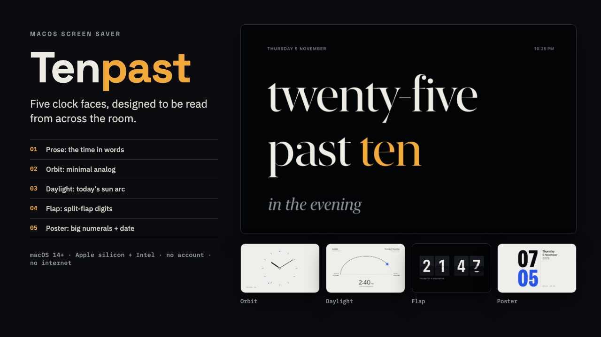

# Tenpast

**Tenpast: Clock Screen Saver for Mac (5 Faces)**

Tenpast.saver (5 clock faces, Apple silicon + Intel, macOS 14+) plus a 10-page START-HERE.pdf install guide.

**Price:** $14 · **Category:** Design · **Edition:** 2026-11

### [Get it on Gumroad →](https://kitwright.gumroad.com/l/tenpast?utm_source=github&utm_medium=readme&utm_campaign=mac-clock-screensaver)

---

For Mac owners who want the screen to show something calm and useful when they step away: the time, set well and readable from across the room. Tenpast is a screen saver with five original clock faces, built to stay light on your Mac and to install without guesswork.

**Good to know before you buy:** Tenpast is made by an independent developer and is not notarized by Apple. The first time you install it, macOS shows a warning that it could not verify the file. You approve it once in System Settings › Privacy & Security › Open Anyway (about a minute). The download includes a READ ME FIRST.txt and a picture guide for this step.

### What you get

- **5 clock faces**: Prose (the time in words, e.g. “twenty-five past ten, in the evening”), Orbit (minimal analog), Daylight (today’s sunrise-to-sunset arc for your city), Flap (split-flap digits that flip), Poster (big numerals with date, week and day of year).
- **4 palette modes**: Auto (follows macOS light/dark), Light, Dark, and Sun (light between your local sunrise and sunset, dark at night).
- **Options sheet with live preview**: face, 12- or 24-hour time, palette, optional seconds, and your place (78 built-in cities or custom coordinates).
- **START-HERE.pdf** (10 pages): install steps with diagrams, the exact macOS “Open Anyway” path, how to pick a face, multi-monitor notes, uninstall steps, FAQ and troubleshooting table.
- CHANGELOG.md and LICENSE.txt.

### How it works

1. Unzip, double-click Tenpast.saver, click Install.
2. Open System Settings › Wallpaper › Screen Saver… and select Tenpast (on macOS 14 and 15: System Settings › Screen Saver).
3. Click Options… to choose a face.

Setup takes about 5 minutes. If macOS says it could not verify the file, the guide shows the one-time approval in Privacy & Security, step by step.

Under the hood: every face is drawn live at your display’s native resolution, so it stays sharp on Retina, 5K and 6K screens and on multiple displays. Tenpast redraws only when the time changes (once a minute, or once a second with seconds on), with no animation loop, and stops all of its timers when the screen saver ends. Sunrise and sunset are calculated on your Mac and match US Naval Observatory times to the minute in our tests. No location permission is needed.

### Who it is not for

- Windows, Linux, iPhone, iPad or Apple TV users: this is a macOS screen saver only.
- Macs running macOS 13 Ventura or older.
- Anyone looking for a desktop widget, a menu bar clock, alarms or timers. Tenpast runs as your screen saver.
- Anyone who wants to design their own clock faces: the five faces and four palettes are fixed in version 1.0.

### Format and requirements

- One ZIP download (under 5 MB) containing Tenpast.saver, READ ME FIRST.txt, START-HERE.pdf, CHANGELOG.md and LICENSE.txt.
- Not notarized by Apple: the first install needs the one-time approval described above.
- Requires macOS 14 Sonoma or later. Universal: runs natively on Apple silicon and Intel Macs. (macOS 27 itself only runs on Apple silicon.)
- Built and tested on macOS 27.0.1 on Apple silicon; the Intel code was tested under Rosetta 2. Not yet tested on macOS 14, 15 or 26, or on Intel hardware.
- No account, no internet connection, no licence server, no subscription.
- This is a digital download. Nothing is shipped.

### Updates

Free updates for this edition (v1.x, edition 2026-11). New versions appear in your Gumroad library under the same purchase.

---

*Tenpast is an independent product and is not affiliated with, endorsed or supported by Apple Inc. Mac and macOS are trademarks of Apple Inc. One licence covers the Macs you personally use; please do not redistribute the download.*

---

**Keywords:** mac screensaver, clock screensaver, macos, word clock, flip clock, minimal clock, desk setup, screensaver

[← All Kitwright kits](../../README.md) · [Buy on Gumroad](https://kitwright.gumroad.com/l/tenpast?utm_source=github&utm_medium=readme_footer&utm_campaign=mac-clock-screensaver)
