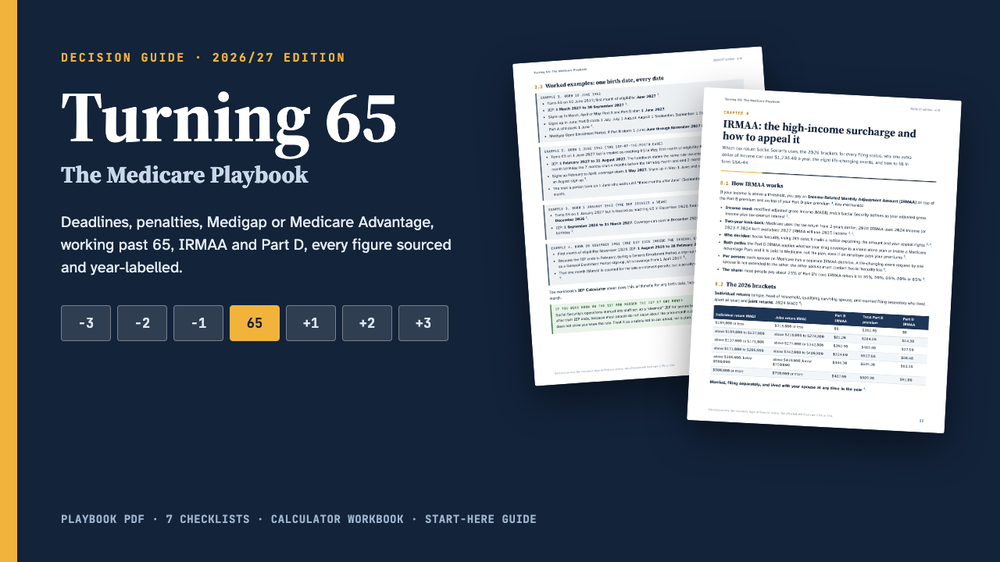

# Turning 65

**Turning 65: The Medicare Playbook 2026/27 (Enrollment, Medigap, IRMAA)**

58-page Medicare playbook PDF, 17-page printable checklists and worksheets, a calculator workbook (IEP dates, penalties, IRMAA) and a START-HERE guide. Sources checked Nov 2026.

**Price:** $29 · **Category:** Business & Money · **Edition:** 2026-11

### [Get it on Gumroad →](https://kitwright.gumroad.com/l/medicare-playbook?utm_source=github&utm_medium=readme&utm_campaign=medicare-playbook)

---

For Americans approaching 65, and the adult children helping them, who want to get Medicare right the first time. The official sites explain each rule on a different page and rarely do the arithmetic for you; this playbook puts the decisions in order, works out the dates and penalties with real numbers, and prints the official source next to every figure.

### What you get

- **The Playbook (PDF, 58 pages, 16 chapters):** the 2026 and 2027 numbers at a glance, your Initial Enrollment Period worked out from a birth date (including the 1st-of-the-month rule), General and Special Enrollment Periods, late-enrollment penalties with worked calculations, Parts A to D in plain English, a decision framework for Original Medicare + Medigap versus Medicare Advantage with scenario tables, Medigap plans compared and every federal guaranteed-issue right, a 24-state table of extra Medigap rights, working past 65 (the 20-employee line, COBRA, forms CMS-40B and CMS-L564, HSA contributions), IRMAA brackets for every filing status with the SSA-44 life-changing-event form step by step, Part D and the $2,400 cap for 2027, Extra Help and Medicare Savings Programs, Medicare Plan Finder step by step, six worked scenarios, common mistakes, a guide for adult children, a glossary and official contacts.
- **Checklists and worksheets (PDF, 17 pages, 7 printables):** documents to gather, an enrollment timeline worksheet, a side-by-side plan comparison worksheet, Medigap shopping, leaving an employer plan, an IRMAA appeal packet, and the yearly October-December review.
- **Calculator workbook (Excel .xlsx, 4 calculators):** IEP calculator from a birth date, Part B penalty calculator, Part D penalty calculator (2026 and 2027), and an IRMAA lookup that shows your bracket and the income room before the next one.
- **START-HERE guide (PDF, 2 pages):** your dates in ten minutes and which pages to read for your situation.

### Why you can rely on it

- Every figure and rule was checked on 5-6 November 2026 against Medicare.gov, CMS fact sheets, Social Security (including its operations manual, POMS), the IRS and the official "Medicare & You 2027" handbook.
- Of the 318 claims in the book's ledger, 254 are confirmed against an official source, 34 are worked examples recalculated by an independent program, and 30 rest on a compilation or a screen layout and are marked as partially verified, with how to check them yourself.
- Year labels throughout: official 2027 figures where CMS and the IRS have published them (Part D cap and deductible, penalty base premium, Extra Help copays, HSA limits); 2026 Part B premiums, deductibles and IRMAA brackets, clearly labelled, because CMS had not published the 2027 amounts on 6 November 2026. The book tells you exactly where they will appear.
- Where official sources disagree (for example a typo in Social Security's IRMAA table), the book says so.

### How it works

Open START-HERE.pdf, type a birth date into the workbook, and read the pages listed for your situation: about ten minutes to know your Initial Enrollment Period and first deadline. The workbook needs no setup; blue cells are inputs.

### Who it is not for

- People on Medicare because of a disability under 65, End-Stage Renal Disease or ALS: several rules differ and are not covered in detail.
- Anyone looking for a recommendation of a specific plan or insurer: this guide explains decisions and trade-offs; it does not sell or recommend plans.
- Residents of U.S. territories, where Extra Help and Medicare Savings Programs work differently.

### Format and requirements

- One ZIP download with three PDF files (US Letter), one Excel .xlsx workbook (no macros), a changelog and a licence.
- Works offline. PDFs open in any PDF reader; the workbook opens in Excel, LibreOffice Calc, Apple Numbers or Google Sheets.
- This is a digital download, not a printed book.

### Updates

Free updates for this edition (2026/27), including the update with the 2027 Part B premium and IRMAA brackets once CMS publishes them. The changelog lists what changed.

---

*Independent publication. Not affiliated with or endorsed by Medicare, the Centers for Medicare & Medicaid Services (CMS) or the Social Security Administration (SSA), or any insurer. Educational only: not insurance, legal, tax or financial advice. For free one-to-one counseling, contact your State Health Insurance Assistance Program (SHIP).*

---

**Keywords:** medicare, turning 65, medigap, medicare advantage, retirement, irmaa, health insurance, caregiver

[← All Kitwright kits](../../README.md) · [Buy on Gumroad](https://kitwright.gumroad.com/l/medicare-playbook?utm_source=github&utm_medium=readme_footer&utm_campaign=medicare-playbook)
