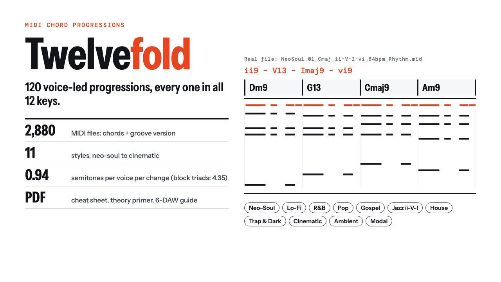

# Twelvefold

**Twelvefold: 120 Voice-Led MIDI Chord Progressions in All 12 Keys**

2,880 MIDI files: 120 voice-led chord progressions in all 12 keys (chords + groove versions), a 15-page cheat sheet, a DAW guide and an offline browser.

**Price:** $19 · **Category:** Music · **Edition:** 2026-11

### [Get it on Gumroad →](https://kitwright.gumroad.com/l/twelvefold?utm_source=github&utm_medium=readme&utm_campaign=midi-chord-progressions)

---

For producers and songwriters who want chords that sound played, not pasted. Twelvefold is 120 chord progressions in 11 styles, voiced so the hands barely move from chord to chord, in all 12 keys: no block root-position triads, no single four-chord loop transposed 120 times, and every file is a plain Standard MIDI file that drops into any DAW.

### What you get

- **2,880 MIDI files**: 120 progressions × 12 keys × 2 versions (sustained voice-led chords, and a Rhythm or Arp groove that uses the same voicing).
- **11 styles**: Neo-Soul (12), Lo-Fi (12), R&B (11), Pop (12), Gospel (10), Jazz ii-V-I (12), House (10), Trap & Dark (11), Cinematic (10), Ambient (10), Modal (10).
- Extensions where the style uses them (maj9, m11, 13, 7#9, 6/9, sus, add9), walking slash-chord basslines, passing diminished chords, tritone substitutions, borrowed and modal chords. No two progressions are the same loop, even rotated.
- File names carry style, number, key, mode, roman numerals and tempo, for example *NeoSoul_01_Ebmaj_ii-V-I-vi_84bpm.mid*. The chord names are stored inside each file too.
- **Cheat sheet PDF (15 pages)**: every progression with roman numerals, chords in C as a bar grid, a mood note and tempo; a one-page theory primer on why each progression works; a key finder for all six modes.
- **START-HERE PDF (8 pages)**: your first loop in 10 minutes; drag-in, tempo and transpose steps for Ableton Live, FL Studio, Logic Pro, GarageBand, Cubase and REAPER; six quick ways to re-voice; troubleshooting.
- **Offline browser page**: hear every progression in any key in your web browser before you drag it in.

### How it works

1. Unzip, open Browse-Twelvefold.html and play a few progressions in your song's key.
2. Load a piano, keys or pad on an instrument track in your DAW.
3. Drag the .mid file from MIDI › style › key folder onto the track and press play.

Setup takes about 5 minutes the first time. Each key was voiced on its own, so a progression sits in the same comfortable register in E as in C.

How the files were checked: all 2,880 files were read back by two independent MIDI parsers and by Apple's AudioToolbox MIDI file loader; every chord in every key was compared with its chord symbol; every note-on has a note-off. Across the chords files the upper voices move 0.94 semitones per voice per chord change on average, against 4.35 for the same chords as block root-position triads.

### Who it is not for

- Producers looking for melodies, basslines or drum MIDI: this pack is chords (with a bass note) only.
- Anyone who wants audio loops, WAV stems or synth presets: there is no audio in the download.
- Players who need staff notation: chords are given as symbols and roman numerals, not sheet music.
- Anyone after 3/4, 6/8 or odd meters: every loop is in 4/4.

### Format and requirements

- One ZIP of about 2.7 MB: 2,880 .mid files (Standard MIDI File, format 0), START-HERE.pdf, Twelvefold-Cheat-Sheet.pdf, Browse-Twelvefold.html, LICENSE.txt and CHANGELOG.md.
- Works in any DAW that imports MIDI files, including Ableton Live, FL Studio, Logic Pro, GarageBand, Cubase and REAPER. You need your own instrument or plug-in to hear the notes.
- The DAW steps in the guide come from each maker's official manual, checked November 2026. The files have not been opened by hand in every DAW version.
- The browser page runs offline in current Chrome, Safari, Firefox and Edge. No account, no internet, no license key.
- This is a digital download. Nothing is shipped.

### License

Royalty-free use in your own music, including commercial releases, beats you sell or lease, sync and client work. No credit needed. You may not resell or share the MIDI files themselves, as they are or edited, or put them in another pack.

### Updates

Free updates for this edition (v1.x, edition 2026-11) appear in your Gumroad library under the same purchase.

---

*Twelvefold is an independent product and is not affiliated with Ableton, Image-Line, Apple, Steinberg or Cockos. Product names are trademarks of their owners.*

---

**Keywords:** midi chords, chord progressions, midi pack, neo soul, lofi, music production, songwriting, music theory

[← All Kitwright kits](../../README.md) · [Buy on Gumroad](https://kitwright.gumroad.com/l/twelvefold?utm_source=github&utm_medium=readme_footer&utm_campaign=midi-chord-progressions)
