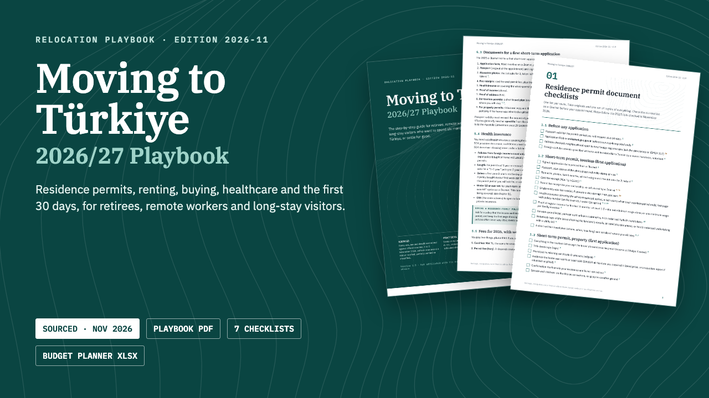

# Moving to Türkiye 2026/27 Playbook

**Moving to Türkiye 2026/27 Playbook: Residence Permits, Renting, Buying**

77-page playbook PDF, 16-page printable checklists PDF, Excel budget and city planner, and a START-HERE guide. Sources checked Nov 2026.

**Price:** $29 · **Category:** Self Improvement · **Edition:** 2026-11

### [Get it on Gumroad →](https://kitwright.gumroad.com/l/moving-to-turkiye?utm_source=github&utm_medium=readme&utm_campaign=moving-to-turkiye-playbook)

---

For retirees, remote workers and long-stay visitors from the UK, Europe, North America, Australia and beyond who want to spend six months or more in Türkiye, or settle. The official rules are spread across a dozen Turkish government sites, change every year, and older guides and forum posts get them wrong; this playbook puts them in order, step by step, with the source printed next to every fact.

### What you get

- **The Playbook (PDF, 77 pages, 21 chapters):** choosing where to live (Antalya, Alanya, Fethiye, Kaş, Bodrum, Kuşadası, İzmir, İstanbul, Mersin, Ankara compared on climate, hospitals, airports, foreign community and rent), entry rules for 18 passports, residence permits step by step with the 2026 fees and worked examples, the digital nomad route, renting and your rights, buying property (2026 costs, the USD 200,000 permit and USD 400,000 citizenship thresholds, the new secure payment system), checking a building for earthquake safety, tax number, e-Devlet, bank, phone (IMEI) registration, healthcare and pensions, driving, money and tax residency, daily life, the first 30 days, four worked scenarios, a question-and-answer chapter, red flags, a glossary with pronunciation and office phrases, and official links.
- **Printable checklists (PDF, 16 pages, 7 checklists):** permit documents by route, first 30 days, apartment viewing, building and earthquake checks, lease, before-you-buy, key dates and travel log.
- **Budget and City Planner (Excel workbook, 7 sheets):** city data, a monthly budget in your own currency with a 12-month inflation and exchange-rate projection, the residence-permit income test, a 2026 permit fee calculator, a place comparison with your own weights, a key-dates sheet, a 90/180-day calculator and a 120-day travel log.
- **START-HERE guide (PDF, 2 pages):** which pages to read first for a scouting trip, a long stay, retiring or buying.

### Why you can rely on it

- Every legal rule, fee, deadline and threshold was checked against official or primary sources (laws, the Official Gazette, the migration authority, the Foreign Ministry, the land registry, the Central Bank and others) between 2 and 5 November 2026.
- Of the 315 claims in the book's ledger, 236 are confirmed against an official or primary source, 63 rest on a secondary source, crowdsourced data or our own arithmetic and are marked as partially verified, and 16 could not be confirmed and are marked as such.
- Each fact carries a source marker; sources are listed with links at the end of every chapter. A verification log lists every partially verified or unconfirmed item, with how to check it yourself.
- It covers what changed recently: Australians visa-free since April 2026, the 2026 fees, the tourism-permit ceiling, closed neighbourhoods, phone registration moving to e-Devlet in July 2026, family doctors no longer free for foreigners, and the property secure payment system from 1 December 2026.

### How it works

Open START-HERE.pdf, pick your situation, and read the pages it lists: about ten minutes to know your first deadline and first document. The workbook needs no setup beyond choosing your currency and a city.

### Who it is not for

- People seeking a job with a Turkish employer (work permits are not covered).
- Refugees and applicants for international or temporary protection.
- Anyone wanting a lawyer to handle their case: this is a self-help guide, not representation.

### Format and requirements

- One ZIP download containing three PDF files (A4), one Excel .xlsx workbook (no macros), a changelog and a licence.
- Works offline. PDFs open in any PDF reader; the workbook opens in Excel, LibreOffice Calc, Apple Numbers or Google Sheets.
- This is a digital download, not a printed book.

### Updates

Free updates for this edition (2026/27). Turkish fees change every January; the changelog lists what changed in each version.

---

*Independent publication. Not affiliated with, or endorsed by, the Government of the Republic of Türkiye or any of its agencies. Not legal, immigration, tax, financial or medical advice. Rules change: verify with the official sources cited before you act.*

---

**Keywords:** turkey, turkiye, relocation, expat, residence permit, retire abroad, digital nomad, moving abroad

[← All Kitwright kits](../../README.md) · [Buy on Gumroad](https://kitwright.gumroad.com/l/moving-to-turkiye?utm_source=github&utm_medium=readme_footer&utm_campaign=moving-to-turkiye-playbook)
