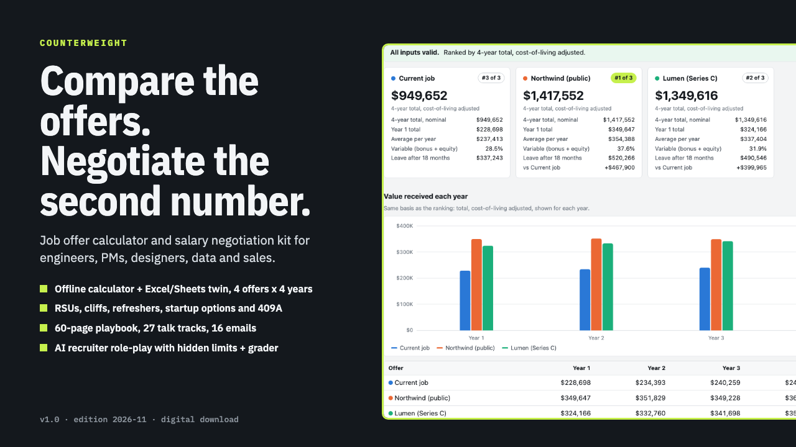

# Counterweight

**Counterweight: Job Offer Calculator & Salary Negotiation Kit for Tech**

One ZIP: an offline offer calculator (HTML + Excel/Sheets twin) comparing up to 4 offers over 4 years, a 60-page negotiation playbook, 16 email templates, an AI role-play practice kit and START-HERE.

**Price:** $39 · **Category:** Business & Money · **Edition:** 2026-11

### [Get it on Gumroad →](https://kitwright.gumroad.com/l/counterweight?utm_source=github&utm_medium=readme&utm_campaign=offer-negotiation-kit)

---

**For engineers, product managers, designers, data scientists and sales people with a job offer on the table, or one on the way.** Counterweight turns every part of an offer (base, bonus, RSUs, startup options, sign-on, 401(k), PTO, commute, cost of living) into one year-by-year number you can compare, then gives you the exact words to ask for more, at every stage from the recruiter's first call to the signed offer.

### What you get

- **Offer calculator** (one HTML file, works offline): compare up to 4 offers over 48 months, year by year, with charts. Public RSUs with front- or back-loaded vesting, cliffs and refreshers; private options and RSUs with strike, 409A vs preferred price, exercise cost, three exit and dilution scenarios and a probability haircut you choose; bonus target times payout; sign-on with repayment clauses; 401(k) match and pension; benefits, PTO, commute and remote costs; your own cost-of-living index; an optional rough after-tax line with rates you set. It also shows what you keep if you leave early, and how much more base, sign-on or RSU value an offer needs to match the top one.
- **Spreadsheet twin** (.xlsx, 10 sheets, formulas only, no macros) for Excel, Google Sheets, LibreOffice and Numbers: the same model as the calculator, as plain formulas you can audit.
- **Negotiation playbook** (PDF, 60 pages, 17 chapters): the salary-expectations question, after the onsite, receiving the offer, the counter, competing offers, exploding deadlines, level and title, equity and sign-on as levers, remote work and start date, sales OTE, internal raises and promotions, and closing. Includes 27 phone talk tracks, 4 worked examples computed by the calculator, what recruiters can and cannot move by company type, and pay-transparency and salary-history tables for US states and cities, Canada and the EU. Every law and limit lists its source and the date we checked it (November 2026).
- **16 email templates** (plain text) with a merge-field list.
- **AI practice kit**: a prompt that turns Claude, ChatGPT or another assistant into a recruiter with hidden limits, 7 scenario cards (engineer, PM, designer, data, sales, internal raise, level), a grader that scores you out of 16, and a prompt to rehearse your own offer.
- **START-HERE.pdf**: your first comparison in about 10 minutes, then the chapter, email and scenario for each stage.

### How it works

Unzip the file and open the calculator in your browser; it starts with a worked example so you can check it in a minute. Type your current job and your offer into two columns (about 10 minutes) and read the ranking, the year-by-year chart and the gap table. Then open the playbook chapter for the stage you are in, rehearse once with the practice kit, and send the matching email.

### Who it is not for

- People who want someone to negotiate for them: this is a do-it-yourself kit.
- Executive packages with change-of-control terms, union or public-sector pay scales, and freelance rate negotiation: the levers are different.
- Anyone who needs a tax calculation: the after-tax line is a rough estimate using rates you type in.
- Anyone looking for tactics that rely on bluffing or invented offers: every script here is honest by design.

### Format and requirements

One ZIP file. The calculator is an .html file that opens in any modern desktop browser (Chrome, Safari, Edge or Firefox) with no internet connection, account or installation. The workbook is an .xlsx file for Excel, Google Sheets, LibreOffice or Apple Numbers. The playbook and START-HERE are PDFs; the templates and practice kit are plain text. The practice kit needs an account with an AI chat assistant. Amounts work in any currency; US-specific items such as 401(k) limits and US laws are labeled. This is a digital download, not a printed book.

### Updates

Free updates for this edition. Laws, limits and sources are dated; when we correct or refresh them, the new files appear in your Gumroad library.

### Disclaimer

General information, not legal, tax or financial advice. No outcome is guaranteed. The example people and companies are fictional. Counterweight is not affiliated with Levels.fyi, Glassdoor, Blind, Anthropic, OpenAI, Microsoft, Google, Apple or any employer; their names are used only to describe sources and compatible software.

---

**Keywords:** salary negotiation, job offer, offer calculator, compensation, negotiation, stock options, tech careers, career

[← All Kitwright kits](../../README.md) · [Buy on Gumroad](https://kitwright.gumroad.com/l/counterweight?utm_source=github&utm_medium=readme_footer&utm_campaign=offer-negotiation-kit)
