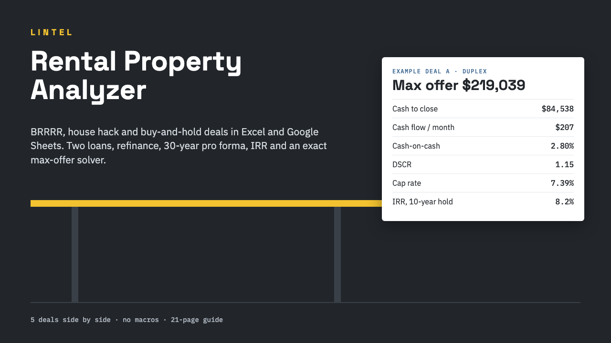

# Lintel Rental Property Analyzer

**Lintel Rental Property Analyzer: BRRRR, House Hack, Buy & Hold (Excel/Sheets)**

One ZIP: a formula-only rental property analyzer workbook for Excel, Google Sheets and LibreOffice (5 deals, BRRRR refinance, max-offer solver, 30-year pro forma, no macros), a 21-page guide and START-HERE.pdf.

**Price:** $39 · **Category:** Business & Money · **Edition:** 2026-11

### [Get it on Gumroad →](https://kitwright.gumroad.com/l/lintel-rental-analyzer?utm_source=github&utm_medium=readme&utm_campaign=rental-property-analyzer)

---

For buy-and-hold, BRRRR and house-hacking investors who want to know, before making an offer, **how much cash a rental needs, what it earns in a normal year, what it returns over the years you hold it, and the most you can pay**. Free calculators give you one cap rate; this workbook models the loans, the rehab, the refinance, the expenses and the sale, and shows every formula.

### What you get

- **Lintel Rental Property Analyzer.xlsx**: 9 sheets plus 5 hidden calculation engines, 63,038 formulas, no macros.

  - **Deals**: inputs for 5 properties side by side, each checked automatically with the first problem named.
  - **Financing**: two purchase loans with points, PMI/MIP (start and stop LTV), interest-only periods, one ARM reset and balloons; hard-money rehab financing.
  - **BRRRR refinance**: ARV, refinance LTV, lender seasoning rule, payoff, costs, net cash-out and cash left in the deal.
  - **Rehab budget**: 10 line items plus contingency, rehab and lease-up months, holding costs.
  - **Income**: rents for up to 8 units, other income, vacancy, rent growth; house hacking (the unit you live in, for how many years, your net housing cost).
  - **Expenses**: property tax, insurance, HOA, utilities, other fixed costs, management %, repairs and CapEx reserves.
  - **Returns**: cap rate, yield on cost, cash-on-cash, DSCR, break-even occupancy, debt yield, GRM, expense ratio, year-1 total return, plus IRR, NPV, equity multiple and total profit for a sale in any year 1-30.
  - **Pro Forma**: 30 years with appreciation, selling costs and an optional US sale-tax estimate (depreciation recapture, capital gains, state tax) you can switch off.
  - **Max Offer**: the highest price that meets your cash-on-cash, DSCR, cap-rate, cash-flow-per-unit or cash-left targets, solved exactly with ordinary formulas (no Goal Seek, no macros, no circular references).
  - **Sensitivity**: 4 tables (price x rent and rate x vacancy) for cash flow, cash-on-cash and DSCR.
  - **Compare**, a monthly **Amortization** schedule for every loan, and a one-page printable **Summary** for lenders and partners.

- **Lintel Guide.pdf** (21 pages): every metric and assumption explained, with five worked example deals (buy-and-hold duplex, BRRRR, FHA house hack, cash condo, ARM with seller carry) and US reference figures verified November 2026 with sources (IRS, CFPB, Fannie Mae, Freddie Mac, Tax Foundation).
- **START-HERE.pdf**: exact steps to your first result in about 10 minutes.

### How it works

1. Open the workbook in Excel, or upload it to Google Sheets.
2. Overwrite the example in column C of Deals with your property: price, rents by unit, loan terms, expenses. Row 5 tells you when every input is valid.
3. Read Analysis, set your targets on Max Offer, and print the Summary page.

The five worked examples from the guide are already typed in, so every sheet shows real numbers the moment you open it. Example: the duplex in column A costs $84,538 to close, cash-flows $207 a month at 7.75%, and meets an 8% cash-on-cash target only at $219,039.

The workbook was recalculated headless in LibreOffice and compared cell by cell with an independent Python implementation of every calculation on 300 randomized deals and 45 edge cases (cash purchase, 0% vacancy, negative cash flow, a refinance that returns more than all your cash, unseasoned refinance, balloons, invalid inputs and more), with no error values anywhere.

### Who it is not for

- Flippers who never rent: the model is built around renting and holding.
- Short-term rental hosts who need nightly pricing and seasonality, and commercial or large multifamily underwriting (more than 8 rent lines, triple-net leases).
- Anyone who wants a tax return: annual income tax is not modelled, and the sale-tax figure is a simplified US estimate.
- Anyone looking for property picks, market forecasts or personal advice.

### Format and requirements

- One ZIP file: 1 .xlsx workbook, 2 PDFs, a changelog and a licence. This is a digital download, not a printed book.
- Works with Microsoft Excel 2010 or later (Windows, Mac or Excel for the web), Google Sheets (free Google account) and LibreOffice Calc 7 or later. Apple Numbers is not supported.
- Uses only 13 common functions that Excel and Google Sheets both document. The automated recalculation tests ran in LibreOffice; Excel and Google Sheets were not part of the automated tests, and START-HERE includes a 1-minute check that your program shows the same numbers as the guide.
- Works offline. No macros, add-ins, accounts or logins.
- Country-neutral: amounts are plain numbers in any currency. US defaults (PMI and FHA rules, depreciation, capital gains) are labelled, and the US tax estimate switches off with one cell.

### Updates

Free updates for this edition (2026-11). Updated files appear in your Gumroad library.

### Disclaimer

Educational tool, not financial, investment, tax or legal advice, not an appraisal and not a loan offer. Results depend entirely on the assumptions you enter; verify rents, taxes, insurance, rehab costs and loan terms before you make an offer. The example deals are fictional. Not affiliated with Microsoft, Google, The Document Foundation, Fannie Mae, Freddie Mac, HUD, the IRS or BiggerPockets.

---

**Keywords:** rental property, real estate, brrrr, house hacking, deal analyzer, excel template, google sheets, cash flow

[← All Kitwright kits](../../README.md) · [Buy on Gumroad](https://kitwright.gumroad.com/l/lintel-rental-analyzer?utm_source=github&utm_medium=readme_footer&utm_campaign=rental-property-analyzer)
