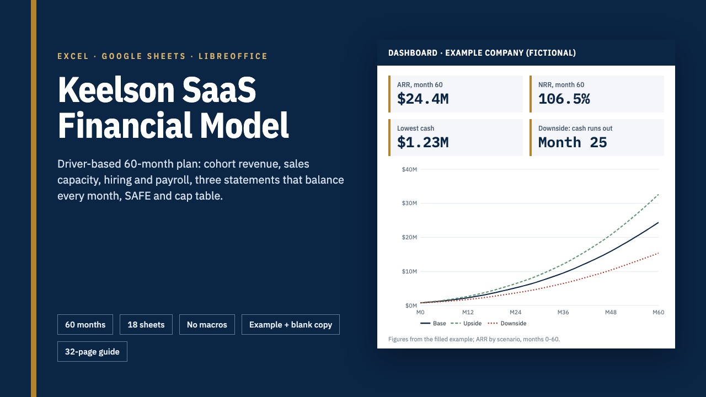

# Keelson SaaS Financial Model

**Keelson SaaS Financial Model: 60-Month Startup Model for Excel & Google Sheets**

One ZIP: an integrated 60-month SaaS financial model (18 sheets, three statements, cohorts, cap table, 6 charts, no macros) as a filled example and a blank copy, a 32-page guide and a START-HERE PDF.

**Price:** $79 · **Category:** Business & Money · **Edition:** 2026-11

### [Get it on Gumroad →](https://kitwright.gumroad.com/l/keelson-saas-model?utm_source=github&utm_medium=readme&utm_campaign=saas-financial-model)

---

**For founders of seed and Series A software companies who need a financial model that investors take seriously and that they can actually explain.** Most templates are a static P&L where you type a growth rate; this one builds revenue, costs, cash and ownership from drivers you can defend: cost per lead, rep capacity, cohort retention, hires and rounds.

It is a complete, integrated 60-month model in one workbook, with a filled example of a fictional company, a blank copy for yours, and a 32-page guide that explains every block and gives dated benchmark ranges for each assumption.

### What you get

- **The workbook (18 sheets, 55,000+ formulas, no macros)**, as a filled example and a blank copy:

  - Monthly engine for 60 months with an opening balance sheet, rolled up to 20 quarters and 5 years.
  - Cohort-based revenue for up to 3 plans: new, expansion, contraction and churned MRR by monthly cohort, early-life and steady-state churn, annual prepay with deferred revenue, plus a usage-based add-on.
  - Acquisition from 3 paid channels (cost per lead, conversion, CAC by channel), organic growth and a sales-capacity model (AE hiring, ramp, quota, attainment, commissions).
  - Hiring plan with 40 rows by department, hire and end months, salaries, benefits load, employer payroll taxes with yearly wage caps, raises, recruiting and equipment.
  - Cost of revenue (hosting per customer, usage cost, payment fees, driver-based support team) and operating expenses.
  - Three statements that balance every month: P&L, balance sheet and cash flow with deferred revenue, receivable and payable days, capex and depreciation, tax with loss carryforwards, interest without circular references, and a venture-debt schedule.
  - Fundraising: post-money SAFE conversion (cap or discount), two priced rounds with option-pool top-ups, and a fully diluted ownership table.
  - SaaS metrics: ARR, cohort-based NRR and GRR, CAC, CAC payback, LTV:CAC, magic number, burn multiple, Rule of 40, runway.
  - Base / Upside / Downside switch, two exact sensitivity grids, a dashboard with 6 native charts, 40 automated checks and an assumptions log.

- **Guide (32-page PDF):** how each block works, how to set each assumption with benchmark ranges and their sources (retention, sales productivity, payroll taxes, payment fees, round sizes and dilution, venture-debt terms, all checked November 2026), how to present the model to investors, and twenty common mistakes.
- **START-HERE PDF:** your runway from your own numbers in about 10 minutes.

### How it works

1. Open START-HERE.pdf, then the example workbook, and read the dashboard (2 minutes).
2. Switch the scenario to Downside and see where cash runs out.
3. Open the blank copy and type your plans, customers, team and cash into the marked input cells. A first full pass takes about 30 minutes with your billing and payroll exports at hand.

### Who it is not for

- Companies that are not subscription software: marketplaces, e-commerce, hardware or services businesses need different revenue engines.
- Anyone needing more than 3 plans, 3 paid channels or one debt tranche in one file, or a planning horizon other than 60 months.
- Teams that want an accounting system or audited statements. This is a planning model.

### Format and requirements

- One ZIP file (about 2 MB) with two .xlsx workbooks and two PDFs (US Letter), plus a changelog and licence.
- Works in Microsoft Excel (Microsoft 365 or 2019 and later, Windows or Mac), Google Sheets (upload and open with Google Sheets) and LibreOffice Calc. Formulas are limited to 20 functions that all three document with the same behaviour; the automated tests recalculate every case in LibreOffice 26.2. No macros, add-ins, data tables or internet connection. Apple Numbers is not tested or supported.
- Amounts are currency-neutral; payroll-tax defaults follow US 2027 rules and are editable.
- This is a digital download, not a printed book.

### Updates

Version 1.0, edition 2026-11. Free updates for this edition. Benchmarks and tax figures that change carry a "verified" date and a source in the guide.

### Disclaimer

Independent product, not affiliated with or endorsed by Microsoft, Google, The Document Foundation, Y Combinator, Carta, Stripe or any company or publisher cited; all trademarks belong to their owners. The example company is fictional. This is a planning and educational tool, not financial, investment, tax, accounting or legal advice, and projections are not guarantees. It does not promise any funding or business outcome.

---

**Keywords:** financial model, saas, startup, excel template, google sheets, fundraising, cap table, saas metrics

[← All Kitwright kits](../../README.md) · [Buy on Gumroad](https://kitwright.gumroad.com/l/keelson-saas-model?utm_source=github&utm_medium=readme_footer&utm_campaign=saas-financial-model)
