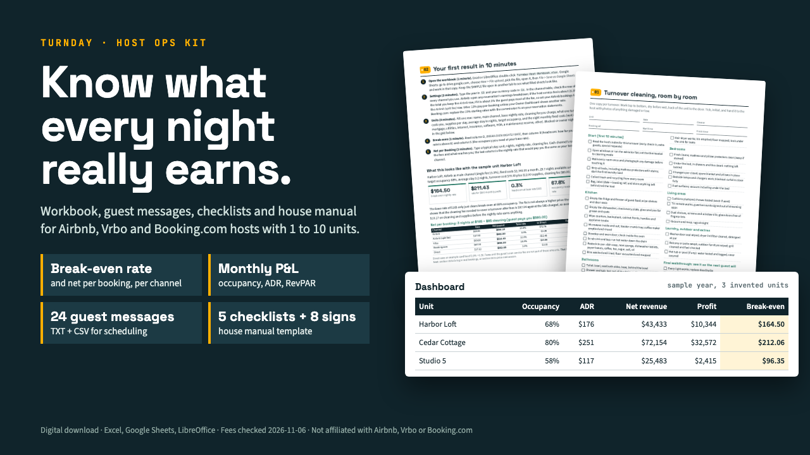

# Turnday Host Ops Kit

**Turnday Host Ops Kit: Airbnb & Vrbo Host Workbook, Messages, Checklists**

One ZIP: a 15-sheet workbook for Excel or Google Sheets (blank + sample), 24 guest messages (TXT + CSV), 5 printable checklists, a house manual and 8 signs (DOCX), START-HERE PDF.

**Price:** $29 · **Category:** Business & Money · **Edition:** 2026-11

### [Get it on Gumroad →](https://kitwright.gumroad.com/l/turnday-host-kit?utm_source=github&utm_medium=readme&utm_campaign=str-host-kit)

---

For hosts running 1 to 10 short-term rental units on Airbnb, Vrbo, Booking.com and direct bookings who want to know what each unit really earns after platform fees and cleaning. Most host spreadsheets stop at revenue; this kit gives you your break-even nightly rate, the net payout of every booking on every channel, and the guest messages and checklists to run each stay, ready to use the same day.

### What you get

- **Host workbook (Excel / Google Sheets / LibreOffice, 15 sheets, formulas only, no macros):** unit P&L by month for all units or one unit; occupancy, ADR and RevPAR; fee-aware net payout per booking; break-even nightly rate, the rate for a profit target and the occupancy you need; a cleaning and turnover cost tracker; an expenses log with shared costs; a pricing calendar with seasons, weekday multipliers, event days and an optional floor at break-even; an import sheet that reads your Airbnb, Vrbo or Booking.com earnings CSV; and a Messages sheet that fills your unit's details into every template. Holds up to 10 units and 1,000 bookings a year. Comes blank and as a filled SAMPLE year (3 invented units) so you can see every sheet working.
- **24 guest message templates** for the whole stay: inquiry replies, booking confirmation, pre-arrival with check-in steps, arrival-day door code, first-evening and mid-stay checks, checkout reminder, review request, issues, damage, refund and cancellation requests, early check-in, late checkout and extensions. As plain text and as a CSV with trigger, day offset and send time for scheduling tools, plus a list of all 55 {fields}.
- **5 printable checklists (8 pages):** turnover cleaning room by room with restock par levels, monthly maintenance with a 12-month log, safety (smoke and CO alarms, fire extinguisher, first aid kit), new unit launch from 60 days out, and local rules to check.
- **House manual template** (editable DOCX and Markdown, 8 sections) with a filled sample PDF, and **8 printable signs** (Wi-Fi, house rules, checkout, trash, heating, emergency, bathroom, parking) as DOCX plus a filled sample.
- **3 sample platform exports** to practise the CSV import, and a **START-HERE guide (17 pages)** with exact steps, worked examples and troubleshooting.

### Checked against the platforms' own help pages

- Host fee models and typical percentages (Airbnb single fee of 15.5% for most hosts and the 3% split fee; Vrbo 12% pay-per-booking; Booking.com commission rules), payout timing, how cleaning fees are charged, and the Airbnb and Vrbo export paths were checked on 2026-11-06. Each fact carries its source link inside the kit.
- Where a platform does not publish a figure (Booking.com has no single commission rate; Airbnb and Booking.com do not document their export column names), the kit says so and gives a clearly labeled starting value. Every fee is editable on one Settings sheet.
- The workbook's calculations are checked cell by cell against an independent Python implementation in automated tests, on the sample year and on randomized data, with the spreadsheet recalculated in LibreOffice under two different locales.

### How it works

1. Open START-HERE.pdf and the workbook.
2. Check the fee row for each channel you use, then add one unit with its rates, cleaning cost and fixed costs.
3. Read your break-even nightly rate and compare channels on the Net per Booking sheet. That first result takes about 10 minutes; loading a unit fully takes about an hour.

### Who it is not for

- Property managers with more than 10 units or 1,000 bookings a year in one file: you need a property management system.
- Hosts looking for dynamic pricing: the pricing calendar is rules-based and does not see market demand.
- Anyone who wants the rules and taxes for their city answered: the kit gives you the list of questions to ask, not the answers.

### Format and requirements

- One ZIP file: an .xlsx workbook (blank and sample), PDFs, .docx and .md templates, .txt and .csv message files.
- Needs Microsoft Excel, Google Sheets (free) or LibreOffice (free) for the workbook, a PDF reader, and Word, Google Docs, Pages or LibreOffice for the .docx templates. Apple Numbers is not supported. Works offline; no account or login.
- Amounts work in any currency. Checklists and signs are US Letter and print on A4 with "fit to page".
- This is a digital download, not a printed book.

### Updates

Free updates for this edition (2026-11). Platform fees change; the changelog in the download lists what changed in each version.

---

*Independent product. Not affiliated with, endorsed by or sponsored by Airbnb, Vrbo, Expedia Group or Booking.com; their names are used only to describe compatibility. Not legal, tax or accounting advice. Sample data is invented.*

---

**Keywords:** airbnb host, vrbo, booking.com, short term rental, vacation rental, host templates, rental spreadsheet, house manual

[← All Kitwright kits](../../README.md) · [Buy on Gumroad](https://kitwright.gumroad.com/l/turnday-host-kit?utm_source=github&utm_medium=readme_footer&utm_campaign=str-host-kit)
