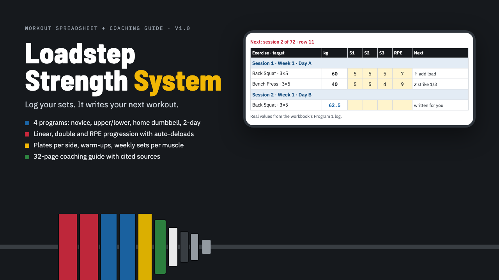

# Loadstep Strength System

**Loadstep Strength System: Auto-Progressing Workout Spreadsheet + 4 Programs**

Workbook (.xlsx) with 4 auto-progressing programs, a 32-page coaching guide PDF and START-HERE.pdf. Excel, Google Sheets, LibreOffice.

**Price:** $29 · **Category:** Fitness · **Edition:** 2026-11

### [Get it on Gumroad →](https://kitwright.gumroad.com/l/loadstep?utm_source=github&utm_medium=readme&utm_campaign=strength-training-system)

---

**A strength training spreadsheet that writes your next workout from what you logged.** For beginners and intermediates training at home or in a gym who want progressive overload without guessing the next weight or keeping notes on when to back off.

You type the reps of each set (and, if you like, how hard the hardest set felt). The workbook decides the next load for every exercise, counts stalls, schedules deloads and adds up your weekly sets per muscle group.

### What you get

- **Workbook (.xlsx)** with 4 original programs, each with its own phone-friendly log for 24 weeks:

  - Novice Linear 3-Day: full body, add load every session until it stalls
  - Upper/Lower 4-Day Undulating: a 3-week wave on squat, bench, press and deadlift with RPE-based loads
  - Home Dumbbell 3-Day: dumbbells and bodyweight only, double progression
  - Busy 2-Day Full Body: two sessions a week, fixed RPE targets

- **3 exercise options per slot** (57 slots in total), for example back squat, goblet squat or leg press
- **3 progression methods in plain formulas:** linear progression, double progression and RPE autoregulation, plus automatic deloads after 3 stalled sessions and a return-from-break rule
- **e1RM** with Epley or Brzycki (your choice), RPE or RIR input, kg or lb
- **Weekly sets for 10 muscle groups** against editable landmark ranges, plus e1RM and volume charts
- **Tools:** plate calculator for your own plates, warm-up generator, kg/lb converter, start-weight finder, a plate chart
- **Coaching Guide (PDF, 32 pages):** every rule written out with worked examples, technique cues and common errors for the main lifts, how to train around pain and travel, nutrition basics with evidence grades, and 32 cited sources (position stands and meta-analyses, verified November 2026)
- **START-HERE.pdf:** your first workout planned in 10 minutes

### How it works

1. Pick a program, an exercise option per slot and your start weights on the Setup sheet (a finder suggests start weights from a recent set).
2. Open your program's log and train. Type reps per set; type the weight only if you used a different one.
3. The next session updates instantly: add load, hold, strike or deload, rounded to what your equipment can load.

Setup takes about 10 minutes. No macros, no add-ons, no account, works offline.

### Who it is not for

- Advanced lifters or competitive powerlifters who need peaking blocks, competition attempts or a coach's custom plan.
- Anyone looking for a mobile app with timers and videos: this is a spreadsheet and a PDF guide.
- People with an injury or medical condition who have not been cleared to train.

### Format and requirements

- One zip download: an .xlsx workbook, two PDFs, a changelog and a licence.
- Works in Microsoft Excel (Microsoft 365 or 2016 and later), Google Sheets (import the .xlsx; works in the Sheets phone app) and LibreOffice Calc. Apple Numbers is not supported.
- This is a digital download, not a printed book.

### Updates

Free updates for this edition (2026-11), delivered through the same Gumroad download.

### Disclaimer

General fitness education, not medical advice. Consult a doctor or physiotherapist before training if you have an injury or a medical condition, are pregnant, or are unsure whether exercise is safe for you. Results depend on your training, sleep, nutrition and health; no specific results are promised. Not affiliated with or endorsed by any organisation, author or equipment brand mentioned.

---

**Keywords:** workout spreadsheet, strength training, progressive overload, workout log, lifting program, home workout, dumbbell workout, gym program

[← All Kitwright kits](../../README.md) · [Buy on Gumroad](https://kitwright.gumroad.com/l/loadstep?utm_source=github&utm_medium=readme_footer&utm_campaign=strength-training-system)
