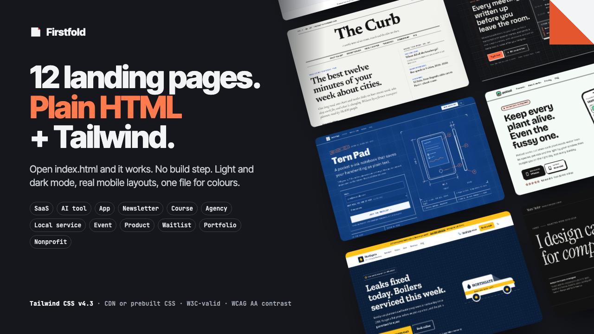

# Firstfold

**Firstfold: 12 Tailwind CSS Landing Page Templates (Plain HTML)**

One ZIP: 12 HTML + Tailwind CSS v4 landing pages with light and dark mode, each in a no-build CDN version and a prebuilt-CSS version, plus a 16-page START-HERE PDF and a component index.

**Price:** $29 · **Category:** Design · **Edition:** 2026-11

### [Get it on Gumroad →](https://kitwright.gumroad.com/l/firstfold?utm_source=github&utm_medium=readme&utm_campaign=tailwind-landing-pages)

---

**For founders, freelancers and small teams who need a good-looking landing page this week and do not want to learn a build tool.** Most Tailwind templates assume you already run npm, break on phones, or look like every other AI-generated page. Firstfold is 12 hand-built pages in plain HTML that open by double-clicking *index.html*, each with its own visual identity.

---

### What you get

- **12 complete landing pages**, one per niche: SaaS, AI tool, mobile app, newsletter, online course, agency/studio, local service, event/conference, physical product, waitlist/pre-launch, portfolio and nonprofit. 135 sections in total: heroes, logo strips, features, pricing (with CSS-only monthly/yearly switches), testimonials, FAQs, schedules, ticket stubs, spec sheets, donation and booking forms, footers and more.
- **Two versions of every page.** *Zero-build:* Tailwind's official CDN script, pinned to v4.3.4 with an integrity hash, so any class you type works instantly. *Production:* a prebuilt, minified tailwind.min.css (17 to 24 KB, about 5 KB gzipped) made with the Tailwind CLI, so the page works offline and is ready to publish.
- **Light and dark mode** on every page: follows the visitor's system setting, with a switch that remembers their choice.
- **One file for colours and fonts.** Each template's theme.css holds 14 colour tokens (light and dark) and 3 font tokens. Change a hex value, reload, done. No rebuild needed for colours.
- **Distinct designs, 20 self-hosted open-source fonts** (no Google Fonts calls): Swiss-grid SaaS, lab-notebook AI tool, neo-brutalist app, newspaper newsletter, spreadsheet-themed course, poster-type agency, workwear-style plumber, gig-poster conference, Scandinavian product page, blueprint waitlist, catalogue portfolio, river-blue nonprofit.
- **No external images.** Every illustration, product mock-up and pattern is inline SVG or CSS: nothing to license, nothing that breaks.
- **START-HERE.pdf**, a 16-page guide: first result in five minutes, editing text, colours and fonts, rebuilding the CSS without Node.js, connecting forms (Netlify Forms, Formspree and similar), and step-by-step deploys to Netlify, Vercel, Cloudflare Pages and GitHub Pages.
- **Component index** (HTML): every section of every template with links, plus a guide to copying sections between templates. They share the same token names, so a copied section takes on the new template's colours.

### How it works

1. Unzip and double-click production/01-ledger-saas/index.html (or any of the 12). It opens fully styled in your browser.
2. Edit the words in index.html and the colours in theme.css with any text editor. Reload to see changes. First result: about five minutes.
3. Drag the folder onto Netlify Drop, Vercel Drop or Cloudflare Pages, or upload it to GitHub Pages. It is live in minutes.

### Quality checks run on every page

- W3C Nu HTML Checker: 0 errors and 0 warnings on all 24 pages (12 templates in 2 versions).
- axe-core accessibility rules (WCAG 2.2 A/AA): 0 violations at 360, 768 and 1280 px wide, in light and dark mode. Text contrast is also measured on the rendered pixels, including text over patterns.
- No horizontal scrolling at 360, 768 or 1280 px; every keyboard focus stop is visible; the CDN version renders identically to the production version.
- Limits: tested in Google Chrome. Not tested in Safari or Firefox, or with screen-reader users.

### Who this is not for

- Anyone who wants React, Next.js, Vue, Astro or WordPress components. These are plain HTML pages (the Tailwind markup can be ported by hand).
- Anyone who needs a drag-and-drop page builder. You edit HTML text in a code or text editor.
- Anyone who needs multi-page websites, blogs, shops or app dashboards. These are single landing pages.
- Anyone looking for finished copy: the text is realistic sample copy for each niche, clearly marked, for you to replace.

### Format and requirements

- This is a digital download: one ZIP file (about 4.6 MB, 266 files), not a printed book and not a hosted service. No logins, no license keys, no Discord.
- Files: HTML, CSS, a small JavaScript file per template (theme switch, mobile menu, demo forms), WOFF2 fonts, a PDF guide.
- To edit: any plain-text editor (VS Code is free). To view: a browser from 2023 or later (Chrome 111+, Safari 16.4+, Firefox 128+, as required by Tailwind CSS v4).
- Nothing to install. Rebuilding the CSS after adding new Tailwind classes is optional and uses Tailwind's free single-file CLI; the guide gives the exact commands for Mac, Windows and Linux.
- Forms are demos until you connect a form service of your choice (the guide shows how).
- Licence: unlimited websites for yourself and your clients; you may not resell or share the templates themselves.

### Updates

Free updates for this edition (v1.x, November 2026). Updates replace the download on Gumroad; your edited copies are never overwritten.

### Disclaimer

Independent product; not affiliated with, endorsed or sponsored by Tailwind Labs, Netlify, Vercel, Cloudflare or GitHub. Tailwind CSS is a trademark of Tailwind Labs Inc. All brand names, people, quotes, prices and figures inside the templates are fictional sample content.

---

**Keywords:** tailwind css, landing page, html template, tailwind, website template, saas template, dark mode, web design

[← All Kitwright kits](../../README.md) · [Buy on Gumroad](https://kitwright.gumroad.com/l/firstfold?utm_source=github&utm_medium=readme_footer&utm_campaign=tailwind-landing-pages)
