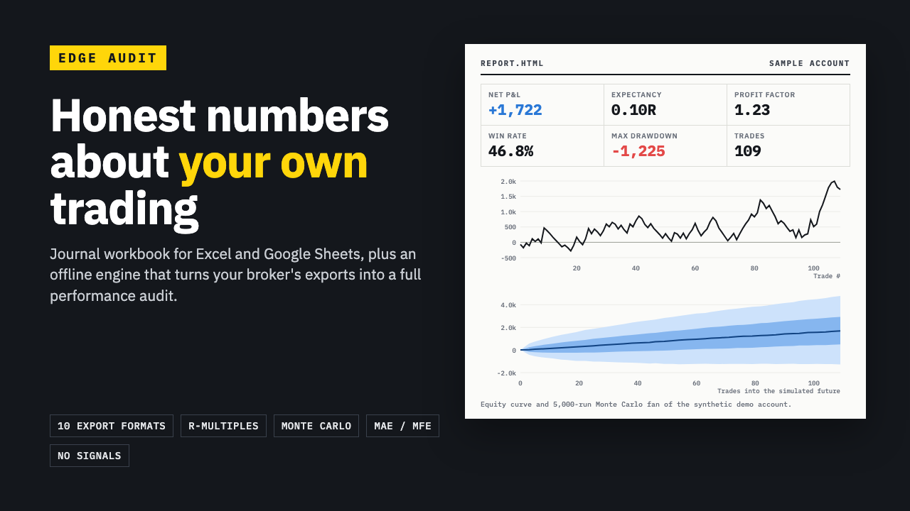

# Edge Audit

**Edge Audit: Trading Journal Workbook + Offline Performance Analytics**

One ZIP: a formula-only journal workbook (Excel/Google Sheets) plus an offline Python engine that reads 10 broker export formats, sample data and 2 PDFs.

**Price:** $39 · **Category:** Business & Money · **Edition:** 2026-11

### [Get it on Gumroad →](https://kitwright.gumroad.com/l/edge-audit?utm_source=github&utm_medium=readme&utm_campaign=trading-journal-analytics)

---

For discretionary and systematic traders in stocks, options, futures, forex and crypto who want honest numbers about their own trading, not signals. Free journals are spreadsheets you type into; Edge Audit also reads the trade history your broker already exports and tells you, with ranges and not just point estimates, whether your edge is real.

### What you get

- **Edge Audit Journal.xlsx**: a formula-only journal for 1,000 trades with setup, tags, mistake, emotion, rating, stop, worst/best price and screenshot columns; a Dashboard with 44 metrics (expectancy and its 95% range, R-multiples, profit factor, drawdown, streaks, Sharpe, Sortino) and tables by setup, mistake, emotion, side, weekday, hour and month; equity and drawdown charts; a position-size sheet. Plus a copy filled with 83 sample trades.
- **An offline analytics engine** (Python 3.9+, standard library only, nothing to install) that imports 10 export layouts: Interactive Brokers Flex Query and Activity Statement, TradingView Strategy Tester and Paper Trading, MetaTrader 5 history reports (HTML or XLSX, any terminal language), NinjaTrader 8, Tradovate, Binance spot and USD-M futures, Coinbase, plus any other CSV through a column mapping.
- It pairs fills into round trips (partial fills, scaling in and out, shorts, flips, fees, futures and option multipliers) and writes a **single-file HTML report** that works offline: equity and drawdown charts, R-multiple histogram, MAE/MFE, breakdowns by setup, tag, symbol, weekday and hour, and a **Monte Carlo** resampling of your trade sequence with risk of ruin and drawdown percentiles.
- **Edge Audit Guide.pdf** (20 pages): every metric with its formula, a worked example and how to read it; export steps per platform; the journal workflow; troubleshooting.
- **START-HERE.pdf** (6 pages) and synthetic sample exports for every supported platform, with the expected results.

### How it works

1. Unzip, open START-HERE.pdf, run one command on the sample account and read the report (about 10 minutes).
2. Export your trade history, run the same command on it, then add setups and stops to the generated trades.csv to unlock R-multiples and setup statistics.
3. Or skip Python entirely and journal in the workbook.

Everything runs on your computer. No account, no login, no upload, no subscription.

### Who it is not for

- Anyone looking for trade signals, indicators, strategies or return promises. Edge Audit measures what you did; it does not tell you what to buy.
- Traders who need tax lot reports or wash-sale accounting. Use your broker's tax documents.
- People who will not use a terminal and also do not want to type trades by hand: the import needs one typed command.

### Format and requirements

- This is a digital download (one ZIP, about 1.0 MB), not a printed book or a web app.
- Workbook: Excel 2010 or newer, Google Sheets, LibreOffice or Numbers. No macros.
- Analytics engine: Python 3.9 or newer on macOS, Windows or Linux (free from python.org; macOS often has it already). The report opens in any modern browser.
- Import formats were built from vendor documentation and published sample exports (details and sources in the Guide). Exports change over time; when a column is missing, the error names it, and the column mapping reads any CSV.

### Updates

Free updates for this edition (v1.x): download the latest version from your Gumroad library.

### Disclaimer

Educational software for reviewing your own trading records. Not financial, investment or tax advice, and not a recommendation to buy or sell anything. Past performance does not predict future results; Monte Carlo figures are resamples of your history, not forecasts. Sample data is synthetic. Not affiliated with or endorsed by Interactive Brokers, TradingView, MetaQuotes, NinjaTrader, Tradovate, Binance, Coinbase, CME Group, Microsoft or Google.

---

**Keywords:** trading journal, trade tracker, day trading, trading, google sheets, excel template, forex, crypto

[← All Kitwright kits](../../README.md) · [Buy on Gumroad](https://kitwright.gumroad.com/l/edge-audit?utm_source=github&utm_medium=readme_footer&utm_campaign=trading-journal-analytics)
