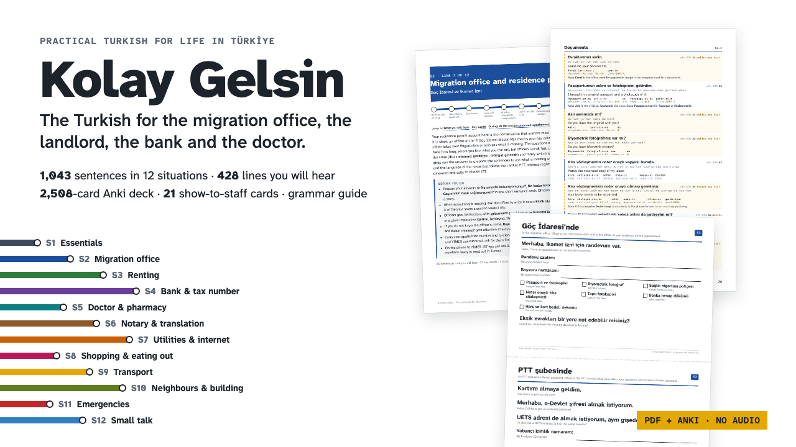

# Kolay Gelsin

**Kolay Gelsin: Practical Turkish for Expats in Türkiye (Phrasebook + Anki)**

1,043 sentences in 12 expat situations (PDF), a grammar guide, 21 show-to-staff cards, an Anki deck (2,508 cards), CSV files and a 30-day plan. No audio.

**Price:** $29 · **Category:** Education · **Edition:** 2026-11

### [Get it on Gumroad →](https://kitwright.gumroad.com/l/turkish-for-expats?utm_source=github&utm_medium=readme&utm_campaign=turkish-for-expats)

---

For expats, retirees and remote workers in Türkiye who need Turkish for the migration office, the landlord, the bank and the doctor, not for ordering coffee on holiday. Phrasebooks teach tourist phrases; this teaches the exact sentences of expat life, with just enough grammar to change them for your own situation.

### What you get

- **Phrasebook by situation** (PDF, 232 A5 pages): 1,043 sentences. Every sentence has the Turkish, a natural English translation, a simple respelling, a literal word-by-word gloss that shows every ending, its level (A1 to B1) and a note when it is formal or informal.
- **428 "what you will hear" lines**: what officials, landlords, doctors, call-centre staff and neighbours actually say to you, with a quick list per situation to read the night before an appointment.
- **16 fill-in dialogs** for key appointments (residence permit, flat viewing, broken boiler, notary, bank account, doctor, pharmacy, 112 call and more), with word boxes and answers.
- **425 key words** and a **161-term glossary of bureaucracy terms** in plain English.
- **Grammar just enough** (PDF, 42 pages, 13 chapters): sounds and stress, vowel harmony, suffix chains, the six cases, verbs, polite forms, numbers, money, dates and addresses, and how to read official forms, with a petition (dilekçe) model and a 24-verb table.
- **21 show-to-staff cards** (PDF, A4, two per page): large Turkish with English underneath, write-in lines and tick boxes, for the migration office, PTT, bank, doctor, pharmacy, notary, utilities, taxi, hairdresser, building manager and emergencies.
- **Anki deck** (1,468 notes, 2,508 cards): one subdeck per situation, tags by situation and level. Lines you say get Turkish-to-English and English-to-Turkish cards; lines you hear get recognition cards only.
- **Spreadsheets**: every sentence and word as CSV, to search, filter or import elsewhere.
- **START-HERE** (PDF): your first result in 10 minutes and a 30-day plan.

The 12 situations:

- **S1 Essentials: getting by politely** (86 sentences)
- **S2 Migration office and residence permit** (89 sentences)
- **S3 Renting: viewing, contract, landlord problems** (88 sentences)
- **S4 Bank and tax number** (86 sentences)
- **S5 Doctor, pharmacy and hospital** (88 sentences)
- **S6 Notary, sworn translation, power of attorney, apostille** (85 sentences)
- **S7 Utilities, internet and mobile line** (88 sentences)
- **S8 Shopping, markets, bargaining and eating out** (88 sentences)
- **S9 Getting around: public transport, taxis and driving** (86 sentences)
- **S10 Neighbours and building manager** (88 sentences)
- **S11 Emergencies: 112, police, accidents and earthquakes** (86 sentences)
- **S12 Small talk: neighbours, invitations and special occasions** (85 sentences)

### How it works

Open START-HERE.pdf. In 10 minutes you learn the sounds, five sentences that open any conversation politely, and print your first card. Importing the Anki deck takes about 5 minutes. After that, 20 to 30 minutes a day following the 30-day plan, or jump straight to the situation of your next appointment.

How the Turkish was checked: every sentence passed automated vowel-harmony and suffix checks, a Turkish (Hunspell tr_TR) spell check, and a separate line-by-line review for correctness and naturalness. Standard Istanbul Turkish, with correct ğ, ı, İ, ş, ç, ö and ü throughout.

### Who it is not for

- Complete beginners who want a full course with audio and a teacher's voice: this edition has **no audio**. START-HERE explains free ways to hear any sentence with your phone's or computer's Turkish voice.
- Tourists on a one-week trip: a pocket phrasebook is enough.
- Anyone looking for legal advice on permits, leases or taxes: this is a language book. It gives you the words for procedures, not the rules.

### Format and requirements

- This is a digital download, not a printed book: one ZIP file with 4 PDFs, 1 Anki deck (.apkg), 2 CSV files, a changelog and a licence.
- Any PDF reader on a phone, tablet or computer. The cards print on A4 or US Letter (fit to page).
- For the flashcards: Anki (free on Windows, Mac, Linux and Android; AnkiMobile for iPhone is a paid app). Optional.
- Instructions in English. Works offline; no account or login needed.

### Updates

Free updates for this edition. Corrections are listed in the changelog inside the download.

---

*Not affiliated with any government office, company or brand named in the examples. Not legal, tax, immigration or medical advice. For the procedures themselves (documents, fees, deadlines) ask the office, or see our companion guide Moving to Türkiye 2026/27 Playbook.*

---

**Keywords:** learn turkish, turkish, turkiye, turkey, expat, phrasebook, anki, language learning

[← All Kitwright kits](../../README.md) · [Buy on Gumroad](https://kitwright.gumroad.com/l/turkish-for-expats?utm_source=github&utm_medium=readme_footer&utm_campaign=turkish-for-expats)
